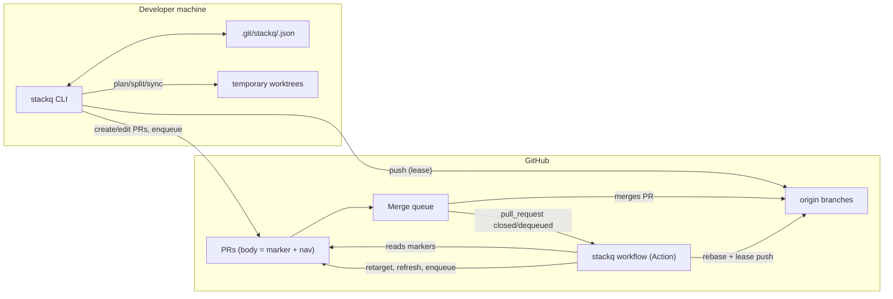
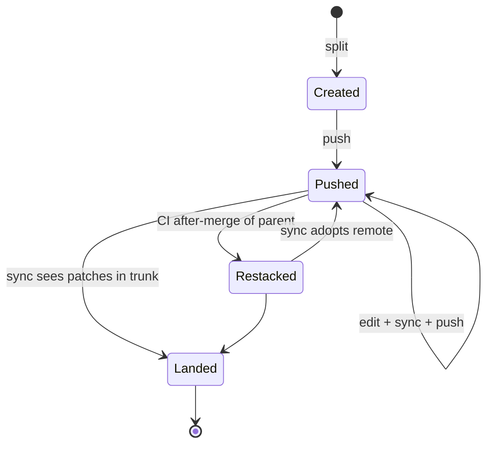
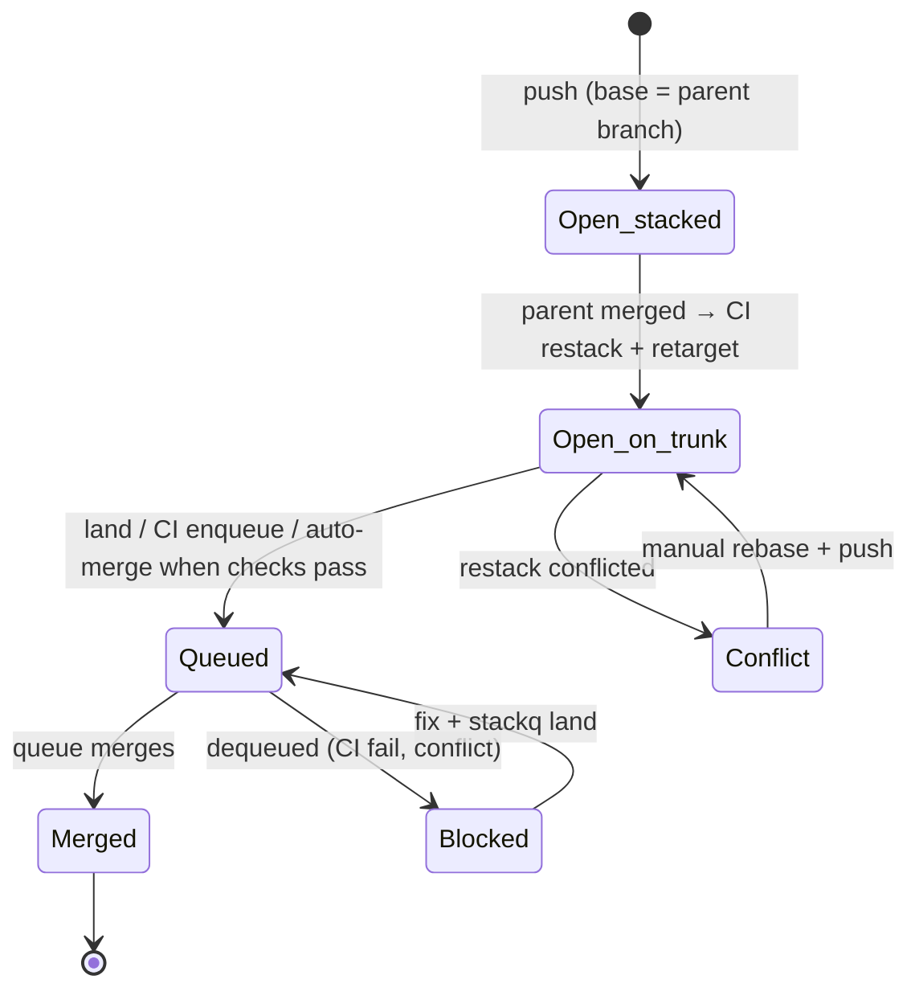

# stackq: design and technical specification

Status: v0 prototype, built 2026-10-15. Single-author handoff document.
Audience: you, picking this up on a laptop with no other context.

This document describes what stackq is, why it is shaped the way it is, exactly how every part works today, what is known to be missing or wrong, and what to do next. Where the code and this document disagree, the code wins. Please fix this document when you notice.

---

## Table of contents

1. [Summary](#1-summary)
2. [Problem](#2-problem)
3. [Goals and non-goals](#3-goals-and-non-goals)
4. [Terminology](#4-terminology)
5. [User workflows](#5-user-workflows)
6. [Architecture](#6-architecture)
7. [Repository layout](#7-repository-layout)
8. [Data model and persisted state](#8-data-model-and-persisted-state)
9. [Split planning algorithm](#9-split-planning-algorithm)
10. [Stack creation (materialization)](#10-stack-creation-materialization)
11. [Sync algorithm](#11-sync-algorithm)
12. [Push algorithm](#12-push-algorithm)
13. [PR body format and the marker protocol](#13-pr-body-format-and-the-marker-protocol)
14. [Merge queue integration](#14-merge-queue-integration)
15. [CI / GitHub Action](#15-ci--github-action)
16. [GitHub API surface (forge layer)](#16-github-api-surface-forge-layer)
17. [git layer](#17-git-layer)
18. [CLI reference](#18-cli-reference)
19. [Configuration reference](#19-configuration-reference)
20. [State machines](#20-state-machines)
21. [Failure modes and recovery](#21-failure-modes-and-recovery)
22. [Security model](#22-security-model)
23. [Testing strategy](#23-testing-strategy)
24. [Known issues and gaps](#24-known-issues-and-gaps)
25. [Design decisions log](#25-design-decisions-log)
26. [Roadmap](#26-roadmap)
27. [AI-assisted stacking and integrity (future design)](#27-ai-assisted-stacking-and-integrity-future-design)
28. [Atomic landing and rollback](#28-atomic-landing-and-rollback)
29. [Feature flags: flags first, activation held](#29-feature-flags-flags-first-activation-held)
30. [Design gaps and further ideas](#30-design-gaps-and-further-ideas)
31. [PR priority in the merge queue](#31-pr-priority-in-the-merge-queue)
32. [Resuming work on a laptop](#32-resuming-work-on-a-laptop)
33. [Appendix: worked example](#33-appendix-worked-example)

---

## 1. Summary

stackq is a Go CLI plus a composite GitHub Action. It has five jobs.

1. **Split.** It takes one large branch and produces an ordered stack of small branches, each holding one commit. The order follows the import graph, so every slice can build on its own. The top of the stack is byte-for-byte identical to the original branch.
2. **Maintain.** It keeps the stack consistent while people review it. You edit a lower branch and everything above is rebased, replaying only each branch's own commits. PRs are opened with the right bases, and every PR body carries a live overview of the whole stack.
3. **Land.** It lands the stack through GitHub's native merge queue. By default the landing is **atomic** (§28): every part is reviewed and checked on its own, then the whole stack goes into the queue as one entry, so trunk gets all of it or none of it, and one revert undoes all of it. An **incremental** mode lands one PR at a time instead. In that mode, when a PR merges, CI restacks the next PR onto trunk, retargets it, pushes it, and queues it. Conflicts and dequeues pause the stack with a comment and a label.
4. **Ship safely behind flags.** When the repo's flag layout is configured (§29), flag definitions land first. The code that switches the feature on is held back in a separate activation PR that is never queued automatically, and entrypoints added outside a flag check are reported.
5. **Prioritize the queue.** With `priority` configured (§31), PRs wait in a labeled pool and stackq feeds GitHub's FIFO queue best-first: vulnerability fixes and reverts jump the queue within a small budget, bot/automerge and small PRs go ahead of large ones, and waiting time ages every PR up so nothing starves.

Locked-in decisions from the planning conversation:

| Decision | Choice |
|---|---|
| Merge queue | GitHub native merge queue |
| Form factor | Go CLI + GitHub Action |
| Merge method assumed | Rebase. CI works with any method; local sync detection needs rebase or merge (§24). |
| Scope | Auto-split, create/sync stack, enqueue and restack, conflict/CI handling |
| Landing | Atomic by default (one queue entry, one revert); incremental available (added 2026-10-16) |
| Flags | Flag definitions first; activation held in a hand-merged PR (added 2026-10-16) |
| Priority | Pool + admission control on GitHub's FIFO queue; jumps only for urgent PRs, bounded (added 2026-10-16) |

---

## 2. Problem

Large PRs are hard to review and risky to merge. The standard fix is stacking: split the work into ordered branches where each one builds on the previous, and open one PR per branch. Each PR shows only its own diff.

Stacking has two well-known pain points, and a merge queue adds a third.

1. **Splitting is manual and error-prone.** Choosing which files go where, and in what order, is tedious. A bad order produces intermediate branches that don't compile, and CI fails on every PR but the last.
2. **Restacking is manual.** Editing a lower branch means rebasing every branch above it. Done naively (`git rebase parent`), this replays the parent's old commits and produces conflicts against their rewritten versions. The correct operation is `git rebase --onto <new-parent> <old-parent-tip> <branch>`, which requires remembering the old parent tip.
3. **GitHub's merge queue does not understand stacks.**
   - The queue only accepts PRs whose base is the protected branch. Upper PRs in a stack target other branches, so they cannot be queued.
   - With the rebase or squash method, a merged PR's commits land on trunk with **new SHAs**. The next PR in the stack still contains the old SHAs. Retargeting it to trunk without a rebase shows the parent's changes again in the diff, and often conflicts.
   - GitHub's "automatically delete head branches" setting retargets child PRs to trunk when the parent branch is deleted. This makes the retarget happen, but it does not perform the rebase, so the diff is wrong until someone fixes it.

stackq automates all three.

---

## 3. Goals and non-goals

### Goals

- **G1.** Produce a split in which every intermediate branch is a valid state, enforced optionally by a `--check` command such as a build.
- **G2.** Guarantee the top of the stack equals the source branch exactly, verified by a tree comparison before any branch is created.
- **G3.** Never modify the user's working tree during split or rebase operations. Use temporary worktrees.
- **G4.** Never lose work on push. Every push is a `--force-with-lease` against the SHA stackq itself last pushed or observed.
- **G5.** Land through the native GitHub merge queue with no human action between merges, in the happy path.
- **G6.** Stop safely and visibly on any problem. Abort rebases fully, never push half-states, and comment on the PR with specific files and next steps.
- **G7.** Need no server and no database. CI derives everything from PR bodies and git; local state is a JSON file in `.git`.
- **G8.** Have minimal dependencies: the Go standard library only, the `git` CLI, and the `gh` CLI.
- **G9.** All or nothing (atomic mode). Trunk never holds part of a stack, and a whole stack is rolled back with one revert PR (§28).
- **G10.** No half-built feature goes live. Flag definitions land first, defaulting to off; activation is a separate, human decision (§29).
- **G11.** Urgent and cheap PRs don't wait behind expensive ones, without making the queue rebuild constantly (§31).

### Non-goals (for v0)

- Hunk-level automatic splitting. A file never spans two slices.
- Supporting forks. Stack branches must live in the same repo as the base.
- Parallel or speculative queueing of a whole stack. See §14.4 for why.
- Non-GitHub forges (GitLab merge trains, Gerrit). The forge interface is designed so they could be added later.
- A UI beyond the CLI output and the PR body overview.
- Any model or LLM involvement. v0 is fully deterministic. The future AI-assisted design is in §27, and it keeps every integrity check deterministic.

---

## 4. Terminology

| Term | Meaning |
|---|---|
| **Trunk** | The protected branch PRs land on, usually `main`. |
| **Trunk ref** | `origin/main` if the remote-tracking ref exists, else `main`. Used as the split base and for landing detection. |
| **Source branch** | The big branch being split, such as `feature/big-refactor`. |
| **Fork point / base** | `git merge-base <trunkRef> <source>`, the commit all slices are built on. |
| **Change** | One file in the diff fork-point..source: status A, M, D, R, C or T, path, old path, line counts. |
| **Group** | Files that must travel together. By default, all changed files in one directory. |
| **Slice** | One or more consecutive groups packed under a line budget. Each slice becomes one commit, one branch and one PR. |
| **Stack** | The ordered list of slice branches, bottom (on trunk) to top. |
| **Parent** | The branch a stack branch is built on: the previous branch, or trunk for the bottom one. |
| **ParentTip** | The parent commit the branch was last built on. This is the `<upstream>` argument to `rebase --onto`. |
| **PushedSHA** | The SHA stackq last pushed for a branch, or adopted from a CI restack. It is the lease value. |
| **Marker** | Hidden JSON in the PR body: `<!-- stackq:meta {...} -->`. |
| **Managed block** | The region of the PR body between `<!-- stackq:begin -->` and `<!-- stackq:end -->`. stackq owns it; everything else belongs to the author. |
| **Restack** | Rebasing a branch onto its parent's new tip, replaying only its own commits. |
| **Land** | Put a PR into the merge queue, or enable auto-merge so it joins once checks pass. |

---

## 5. User workflows

### 5.1 First split

```sh
git checkout feature/big-refactor
stackq plan                                  # read-only preview
stackq split --check "go build ./..."        # creates stack/big-refactor/NN-* branches (atomic by default)
stackq push --close-source                   # pushes, opens stacked PRs, links + closes the original PR
# … reviewers approve each part …
stackq land                                  # atomic: checks every part, then queues the whole stack once
```

In atomic mode, `land` refuses until every part is approved and green (§28.2). The queue then merges the whole stack as one entry. CI closes the lower parts, deletes their branches, rebases the activation PR (if any) onto trunk, and posts the rollback command.

In incremental mode (`--landing incremental`), `land` queues the bottom PR, and each merge triggers a restack and a queue of the next PR.

### 5.1a Rolling back

```sh
stackq revert --pr <lander>        # one PR that reverts the whole stack on top of today's trunk
stackq revert --pr <lander> --enqueue
```

If the feature is behind a flag, turn the flag off first; it's faster and needs no deploy (§28.5).

### 5.2 Responding to review on a middle PR

```sh
git checkout stack/big-refactor/02-internal-types
# edit, commit (new commits or amend — both work)
stackq sync      # rebases 03.. onto the new 02, replaying only their own commits
stackq push      # lease-protected push, retargets and refreshes PR bodies
```

### 5.3 Picking up after CI restacked

CI rewrote the remote branches after merges. Locally:

```sh
stackq sync      # fetches; adopts CI's version of any branch you haven't touched;
                 # marks landed branches; re-parents the new bottom to trunk
```

If a branch changed both locally and remotely since the last push, sync stops and tells you to reconcile it by hand (§11.2).

### 5.4 Recovering a paused stack

Either a conflict comment with the `stackq:conflict` label, or a dequeue comment with the `stackq:blocked` label, appears on a PR. To recover:

```sh
stackq sync                 # see §24 issue K1: sync aborts on conflict and prints the command
git checkout <branch>
git rebase --onto origin/main <old-parent-tip> <branch>   # as printed; resolve conflicts
stackq sync && stackq push
stackq land                 # or: Actions → stackq → Run workflow → command=land, pr=N
```

`land` removes the `stackq:blocked` and `stackq:conflict` labels.

### 5.5 Status

```sh
stackq status   # per-branch: PR#, landed?, commits on parent, "needs sync", "unpushed"
stackq list     # all stacks in this repo with landed/total counts
```

---

## 6. Architecture



Three layers:

| Layer | Package | Knows about |
|---|---|---|
| Planning | `internal/split` | git diffs, imports, rules. Pure: writes nothing. |
| Stack maintenance | `internal/stack` | branches, local state, PR bodies, pushing. |
| Landing | `internal/land` | PRs and markers only (no local state), git for rebase/push. Runs identically locally and in CI. |

Plus adapters: `internal/git` (git CLI wrapper) and `internal/forge` (GitHub via `gh`, plus an in-memory fake).

Key architectural property: **CI is stateless.** Everything the Action needs (stack name, order, each PR's parent branch, trunk) is in the PR body marker. The pre-merge head SHA of the merged PR comes from the PR object itself (`headRefOid`). This is why the local JSON can be lost without breaking landing.

---

## 7. Repository layout

```
stackq/
├── go.mod                       module "stackq", go 1.22, no dependencies
├── cmd/stackq/main.go           CLI: arg parsing, config, event mapping, output
├── internal/
│   ├── git/git.go               git CLI wrapper, diff parsing, worktrees, rebases
│   ├── split/
│   │   ├── plan.go              grouping, dependency graph, SCC, topo order, packing
│   │   ├── imports.go           Go (go/parser) and JS/TS (regex) import extraction
│   │   ├── glob.go              gitignore-style glob → regexp
│   │   ├── guard.go             Go AST lint: entrypoints added outside a flag guard
│   │   └── plan_test.go
│   ├── stack/
│   │   ├── stack.go             Stack/Branch model, persistence, resolution
│   │   ├── create.go            materialize a plan into branches (+ --check folding)
│   │   ├── sync.go              Sync and Push
│   │   ├── body.go              marker + managed block render/parse/merge
│   │   └── stack_test.go
│   ├── land/
│   │   ├── land.go              Land (atomic/incremental), AfterMerge, finishAtomic, cascade, Dequeued
│   │   ├── revert.go            Revert: identify landed commits per merge method, integrity check, revert PR
│   │   ├── schedule.go          priority pass: pool → eligibility → rank → jump/admit; job summary
│   │   └── land_test.go
│   ├── prio/
│   │   ├── prio.go              classes, matching, scoring with aging, admission decisions
│   │   └── prio_test.go
│   ├── forge/
│   │   ├── forge.go             Forge interface + gh CLI implementation
│   │   └── fake.go              in-memory Forge for tests
│   └── testrepo/testrepo.go     test fixtures: repos, bare origin, simulated rebase-merge
├── action.yml                   composite Action: download (or build), `stackq ci`
├── examples/
│   ├── stackq.yml               workflow to copy into a consuming repo
│   └── ci-merge-group.yml       reminder that CI needs the merge_group trigger
├── .stackq.example.json
├── .github/workflows/test.yml   gofmt, vet, race tests
├── README.md
└── SPEC.md                      this file
```

Size: about 3,600 lines of Go including tests.

---

## 8. Data model and persisted state

### 8.1 Local stack file

Path: `$(git rev-parse --git-common-dir)/stackq/<name>.json`. Using the common dir means every linked worktree sees the same stacks. Writes are atomic: write to `.tmp`, then rename.

```json
{
  "name": "big-refactor",
  "trunk": "main",
  "remote": "origin",
  "source": "feature/big-refactor",
  "sourcePr": 97,
  "sourceNotified": true,
  "landing": "atomic",
  "branches": [
    {
      "name": "stack/big-refactor/01-internal-types",
      "title": "[big-refactor 1/4] internal/types",
      "parent": "main",
      "parentTip": "a9851d11a4…",
      "pushedSha": "3be0…",
      "pr": 101
    },
    {
      "name": "stack/big-refactor/02-internal-core",
      "title": "[big-refactor 2/4] internal/core",
      "parent": "stack/big-refactor/01-internal-types",
      "parentTip": "3be0…",
      "pushedSha": "77c1…",
      "pr": 102
    }
  ]
}
```

Field semantics:

| Field | Set by | Used by |
|---|---|---|
| `parent` | create; sync re-parents to the nearest unmerged ancestor or trunk | push (PR base), sync |
| `parentTip` | create (previous slice's commit, or the fork point for the bottom); updated after every successful sync step | sync: `rebase --onto newTip parentTip branch` |
| `pushedSha` | push; sync, when adopting a CI restack | push lease; sync's local-vs-remote reconciliation |
| `pr` | push | land (bottom PR), status |
| `merged` | sync, via patch-equivalence against the trunk ref | Active() filtering, nav ✅ |
| `sourcePr` (stack) | split `--from-pr`; push `--from-pr`; otherwise push auto-detects the open PR whose head is `source` | bottom PR description, marker `source`, link comment |
| `sourceNotified` (stack) | push, after the link comment is posted | prevents duplicate comments on the original PR |
| `landing` (stack) | split `--landing`, or config `landing`; the CLI default is `atomic` | marker; land; after-merge |
| `hold` (branch) | split, for the activation slice (§29) | draft PR, marker, never queued automatically |

Merged branches stay in `branches` (with `merged: true`) so indexes and the nav stay stable.

### 8.2 Go types

```go
type Branch struct { Name, Title, Parent, ParentTip, PushedSHA string; PR int; Merged bool }
type Stack  struct { Name, Trunk, Remote, Source string; Branches []*Branch }

type Marker   struct { Stack string; Index, Total int; Parent, Trunk string }
type NavEntry struct { Index, PR int; Branch string; Merged bool }

type split.Plan  struct { Base, Head string; Slices []Slice; Warnings []string }
type split.Slice struct { Name string; Groups []string; Files []git.Change; Lines int; Pinned bool }
type git.Change  struct { Status byte; Path, OldPath string; Added, Deleted int; Binary bool }

type forge.PR struct { Number int; NodeID, Title, Body, HeadRef, BaseRef, HeadSHA, State string }
```

### 8.3 Branch naming

`<prefix><NN>-<slug>`. The prefix defaults to `stack/<name>/`, and config may use `{name}`. NN is 1-based and zero-padded to two digits. The slug comes from the slice name: lowercased, runs of anything other than `[a-z0-9]` become `-`, the result is capped at 40 characters, and `.` becomes `root`. Branch names are fixed at creation and never renumbered. The example workflow filters on the `stack/` prefix, so if you change the prefix, update that `if:` too.

---

## 9. Split planning algorithm

Entry point: `split.Make(repo, Options{Base, Head, MaxLines, Rules}) (*Plan, error)`. It is read-only.

### 9.1 Inputs

- `Base`: the trunk ref, `origin/main` when available. The CLI picks this.
- `Head`: the source branch.
- `MaxLines`: the budget per slice, as added plus deleted lines. Default 400. Binary or empty changes count as 1.
- `Rules`: ordered `{name, paths[]}` from config.

### 9.2 Steps

1. **Fork point.** `base = merge-base(Base, Head)`, `head = rev-parse Head`.
2. **Diff.** `git diff --name-status -M -z base head` and `git diff --numstat -M -z base head` are joined by new path. Rename detection uses the default similarity (50%).
3. **Assign each change to a group:**
   0. With a `flags` config (§29): a path matching `flags.activation` goes to the `activation` group (pinned, held, always last); a path matching `flags.paths` goes to the `flags` group (pinned, right after `deps`, before all code).
   1. If a rule matches the path, the key is `rule:NNN` and the group is pinned and named after the rule.
   2. Else, if it is a dependency manifest (`go.mod`, `go.sum`, `go.work`, `go.work.sum`, `package.json`, `package-lock.json`, `pnpm-lock.yaml`, `pnpm-workspace.yaml`, `yarn.lock`, `bun.lock`, `bun.lockb`), the key is `deps`. All manifests share one group, which has category −1.
   3. Else the key is `dir:<dirname(path)>`. One group per directory corresponds to a Go package or a TS folder.
   - Each group's category is the minimum `category(path)` of its files (§9.4).
   - Indexes are maintained along the way. `dirIndex[dir]` lists the groups with non-deleted files in that dir. `deletedIn[dir]` lists the groups that delete files from that dir; a rename counts as a deletion in its old dir.
4. **Build dependency edges.** `edge(a, b)` means *a depends on b* (b must land at or before a).
   - **Import edges.** For each non-deleted Go or JS/TS file, read its content at `head` and extract import targets (§9.3). For each target, find the owning groups and add `edge(fileGroup, targetGroup)`. Resolution tries `dirIndex[target]`; if that's empty, it tries `dirIndex[dirname(target)]` (a JS import of a file inside a folder).
   - **Deletion edges.** For each change that is not a pure add, read its old content at `base` (using the old path for renames) and extract its old imports. If some group deletes files in an imported directory, add `edge(deletingGroup, thisFileGroup)`. This file must stop importing the code before the code is deleted. For Go, only the exact package dir is checked; for JS, both the target and its dirname.
   - **Deps first.** If a `deps` group exists, every other group depends on it.
   - **Rule order.** Rule groups depend on the previous rule group by rule index, so rules land in the order written.
5. **Condense cycles.** Tarjan's SCC runs over the graph with deterministic sorted iteration. Each SCC becomes one merged group:
   - files are concatenated and lines summed,
   - the category is the minimum,
   - the rule is the minimum rule index if any member is a rule,
   - the name is the rule's name if pinned, otherwise the common directory prefix of the members.
   
   A multi-member SCC adds a warning: "import cycle kept together in one slice: …".

   A rename within one directory stays a single change, so both halves land together (two files in one package would declare the same symbols). A rename **across directories** is planned as an add of the new path and a delete of the old one (`splitMoves`). Kept whole, it is a cycle with every importer: importers depend on the new dir, and the deletion of the old dir depends on the importers' old imports. Split, the new copy lands first, importers switch to it, and the old copy is deleted last. The two directories are different packages, so every step builds. Line counts for the two halves are the whole files, not the rename's diff.

   What the import graph cannot see: a moved or renamed *type* that appears in another package's API (for example a function now returns `money.Cents` instead of `util.Cents`) couples that package to its callers, even though no import changed. `--check` catches this and folds the failing slice into the next one, which can pull unrelated slices along. Add a `slices` rule that names the coupled packages so they ship together and nothing else is dragged in.
6. **Topological order.** Kahn's algorithm runs on the condensation. Among ready nodes it always picks the smallest `(category, key)`. This is O(n²) in groups, which is fine for hundreds of directories. Revisit if a split ever has more than about 5,000 directories.
7. **Pack.** Walk the ordered groups and accumulate them into the current slice. Start a new slice when any of these holds:
   - the next group is pinned (from a rule),
   - the current slice is pinned,
   - adding the group would exceed `MaxLines`.
   
   A single group larger than the budget becomes its own slice, with a warning suggesting a rule or a manual split.

   Packing consecutive topo-ordered groups preserves the invariant: **slice i depends only on slices ≤ i**.
8. **Name slices.** Pinned slices take the rule name. Otherwise the name is `nameFor(groups)`:
   - `deps`, if there is nothing else,
   - the single group's dir, if there is one group,
   - otherwise the longest common path prefix,
   - otherwise `<first>-and-<N>-more`.
   
   Files within a slice are sorted by path.

### 9.3 Import extraction

**Go** (`goImports`): `go/parser.ParseFile(..., parser.ImportsOnly)`. Unparseable files contribute no edges and fail silently. Import paths map to repo dirs through `loadGoModules`:
- It lists every `go.mod` in the tree at that revision, excluding `vendor/` and `testdata/`.
- It reads each `module` line and sorts modules by path length, longest first, so nested modules win.
- `example.com/app/internal/core` maps to `<moduleDir>/internal/core`.
- Imports outside every module (stdlib, third-party) are ignored.
- Base and head use separate module maps, so a module rename still resolves old imports.

**JS/TS** (`jsImports`): one regex with four alternations:
- `import … from '…'` and `export … from '…'`, where the binding list may span lines,
- `import '…'` (side-effect imports),
- `require('…')`,
- dynamic `import('…')`.

Only relative specifiers (starting with `.`) are resolved, to `clean(join(dirname(file), spec))`. Bare package names and tsconfig path aliases are ignored (§24, gap G3). The file extensions considered are `.ts .tsx .js .jsx .mjs .cjs .mts .cts`.

### 9.4 Category heuristic (tie-breaker only)

| Cat | Matches (case-insensitive) | Meaning |
|---|---|---|
| −1 | `deps` group | manifests |
| 0 | `.proto .sql .graphql .gql`, or any path segment `proto`, `schema`, `schemas`, `migrations`, `types` | contracts |
| 1 | default | library code |
| 2 | segment `cmd`, `app`, `apps`, `server`, or basename `main.go` | entrypoints |
| 3 | segment `.github`, `deploy`, `infra`, `test`, `tests`, `e2e`, or basename `dockerfile`, `makefile` | infra and tests |
| 4 | `.md .mdx`, or segment `docs` | docs |

The checks run in this order: contracts, docs, infra/tests, entrypoints, default. Categories never override a dependency edge.

### 9.5 Glob semantics (`compileGlob`)

Rule patterns follow gitignore conventions, compiled to an anchored regexp:
- `*` becomes `[^/]*` and `?` becomes `[^/]`.
- `**/` becomes `(?:.*/)?` and a bare `**` becomes `.*`.
- A pattern without `/` (after trimming a trailing `/`) and without a leading `/` matches at any depth.
- A leading `/` anchors to the repo root.
- A trailing `/` means directory: the pattern must match a dir and everything under it.
- Otherwise the pattern also matches anything under a matched path (`(?:/.*)?$`). So `proto` matches `api/proto/x.proto`.

Tested cases are in `TestGlob`.

### 9.6 Complexity

- One `git show` per changed source file at head, plus one per modified or deleted file at base.
- One `ls-tree` per revision, to find the `go.mod` files.

For a 2,000-file change, that is about 4,000 git subprocesses: noticeable, around tens of seconds. An obvious optimization is `git cat-file --batch` (§26).

---

## 10. Stack creation (materialization)

Entry point: `stack.Create(repo, plan, CreateOptions) (*Stack, error)`.

1. **Clobber guard.** `for-each-ref refs/heads/<prefix-without-slash>`. If any branches exist:
   - Without `--force`, error out.
   - With `--force`, delete them. This fails if one is checked out.
   - An existing stack JSON with the same name is also refused without `--force`.
2. **Worktree.** `git worktree add --detach <tmp>/wt <fork point>`. The user's checkout is never touched (G3). Cleanup is deferred and always removes the worktree and its directory, then prunes.
3. **For each slice in order:**
   1. **Stage.**
      - Deletions: `git --literal-pathspecs rm --quiet --ignore-unmatch -- <paths>`.
      - Renames: remove the old path, then check out the new one.
      - Everything else: `git --literal-pathspecs checkout <head> -- <paths>`.
      - Paths are chunked by 200. Literal pathspecs prevent glob characters in filenames from expanding.
   2. **Check (optional).** Run `sh -c <check>` with the worktree as cwd.
      - Pass: log ✓.
      - Fail, not the last slice, and folding enabled: log ✗ and `continue`. The staged changes carry into the next slice; no commit is made.
      - Fail on the last slice: log a warning that the complete branch fails too. This isn't a split problem, and the commit proceeds.
      - Fail with folding disabled: return an error with the last 15 lines of output.
   3. **Commit.** `git commit --quiet --no-verify --allow-empty`, with this message:
      ```
      <name or "first +N" when folded>

      Part of stack <stack>, split from <source> by stackq.
      Slices: <comma-separated original slice names>
      ```
      Hooks are skipped (`--no-verify`) because they were designed for human commits; run your checks through `--check` instead. Author and committer come from the user's git config.
4. **Verify (G2).** `git diff --quiet <top commit> <head>`. On mismatch, return an internal error before creating any branches.
5. **Create branches.** `git branch --force <prefix>NN-<slug> <sha>`. Set the parent chain, with the first branch's `ParentTip` equal to the fork point and each later branch's equal to the previous commit. Save the JSON.

Notes:
- Untracked files produced by `--check` (build outputs) persist in the worktree across slices, but are never committed. See §24, issue K4.
- Each slice is exactly **one commit**, which keeps restacks trivial. Users may add more commits during review; sync handles any number.

---

## 11. Sync algorithm

Entry point: `stack.Sync(repo, stack, SyncOptions{Fetch, RebaseTrunk})`.

### 11.1 Fetch

If `Fetch` is set and the remote exists: `git fetch --quiet --prune <remote>`.

### 11.2 Reconcile with remote (adopt CI restacks)

For each active branch with a remote-tracking ref `<remote>/<name>`, compare the remote SHA `rs`, the local SHA `ls` and the recorded `PushedSHA`:

| Condition | Action |
|---|---|
| Local branch missing | Create it at `rs`; set `PushedSHA = rs`. |
| `rs == ls`, or `PushedSHA == ""`, or `rs == PushedSHA` | Nothing: in sync, never pushed by stackq, or only local moved. |
| `ls == PushedSHA` (only remote moved) | `ResetBranch(name, rs)`; set `PushedSHA = rs`; log "took the version CI restacked". |
| Otherwise (both moved) | Error asking you to reconcile by hand. |

`ResetBranch` uses `git reset --hard` inside the worktree that has the branch checked out, but only if that worktree is clean. Otherwise it uses `git branch --force`.

### 11.3 Landing detection

For each active branch: `merged = FullyApplied(trunkRef, branch)`. This is true when `git cherry trunkRef branch` has no `+` lines, meaning every commit on the branch has a patch-equivalent commit in trunk. That holds for:
- rebase-merges (same patch, new SHA),
- merge commits (same SHAs).

It does **not** hold for squash merges (§24, G1).

### 11.4 Restack

For each active branch in order:

1. **Effective parent.** Walk `Parent` up through merged branches until you reach an unmerged one, or trunk. Set `reparented` if this differs from the stored parent, then store it.
2. Set `tip = rev(branch)` and `newTip = rev(parentRef)`, where parentRef is the trunk ref when the parent is trunk.
3. If `newTip` is an ancestor of `tip`: set `ParentTip = newTip` and continue. Nothing to do.
4. Set `upstream = ParentTip` if `ParentTip` is an ancestor of `tip`, else `""`.
5. **Trunk-churn avoidance.** If the parent is trunk, it was not just reparented, `RebaseTrunk` is off, and `upstream != ""`, skip. The bottom branch is built on an older trunk, which is fine; the merge queue tests against the latest trunk anyway. Use `stackq sync --trunk` to force it.
6. **Rebase.**
   - With `upstream`: `rebase --onto newTip upstream`.
   - Without: a plain `rebase newTip`, which still drops commits whose patches are already upstream.
   - This runs in the worktree that has the branch checked out (which must be clean), or in a temporary worktree.
7. **On conflict.** The rebase is aborted. Save state, and return an error listing the files and the manual command to run. **Sync does not leave you mid-rebase.**
8. **On success.** `ParentTip = newTip`.

Then save.

### 11.5 Correctness argument

Every stack branch is `ParentTip + own commits`. After a rebase it is `newTip + own commits`, and `ParentTip` moves to `newTip`. So the invariant holds inductively. `--onto` with the recorded `ParentTip` cuts away exactly the parent's old commits, even if the parent was amended, squashed or rebase-merged. The fallback plain rebase is only used when the record is missing or doesn't apply. In that case it relies on git's patch-id skipping, which works for rebase-merged parents but can conflict after a squash.

---

## 12. Push algorithm

Entry point: `stack.Push(repo, forge, stack, PushOptions{Draft})`.

1. Require the remote to exist.
2. For each active branch whose local SHA differs from `PushedSHA`:
   - Run `git push --quiet --force-with-lease=refs/heads/<b>:<PushedSHA> <remote> <sha>:refs/heads/<b>`.
   - An empty `PushedSHA` means the lease expects the ref **not to exist**, so stackq never silently overwrites a branch it didn't create.
   - On rejection, return an error saying the branch moved remotely and to run sync.
   - On success, set `PushedSHA = sha` and save.
3. For each active branch, open or retarget its PR:
   - `FindOpenPRByHead(name)`.
   - If there is none, `CreatePR(head=name, base=parent, title=branch.Title, body=RenderBlock(marker, nav), draft)` and record `pr`.
   - If there is one, record its number. If its base differs from the parent, `EditPR(base=parent)`.
4. Refresh bodies. For each active branch, `GetPR` and compute `MergeBody(existing, RenderBlock(...))`; edit only if it changed. This second pass exists because PR numbers for later branches don't exist yet when earlier ones are created.
5. Link the original PR (§12.1).

Titles are set only at creation. User edits to titles are never overwritten.

### 12.1 The original (source) PR

The big branch usually already has a PR. stackq links the stack to it so reviewers are redirected, and the original description is not lost.

1. **Resolve it**, before step 2 above:
   - `push --from-pr N` wins, and is recorded in `sourcePr`.
   - Otherwise the value recorded at split time (`split --from-pr N`) is used.
   - Otherwise stackq looks up the open PR whose head is the source branch (`FindOpenPRByHead(source)`) and records it.
   - `--no-source-pr` skips all of this: no lookup, no description, no comment.
2. **Bottom PR description.** When the bottom PR is created (index 1 only, and only at creation), its body starts with `SourceIntro`:
   ```
   _Split from #97: Big refactor_

   <the original PR's description, with any stackq block stripped>

   <stackq managed block>
   ```
   This text is in the author-owned part of the body, so you can edit it freely. stackq never rewrites it. Upper PRs do not copy the description, which avoids repeating it N times.
3. **Every PR's managed block** says "Split from #97." via the marker's `source` field (§13).
4. **Link comment, once.** If `sourceNotified` is false, stackq comments on the original PR with a numbered list of every stack PR and branch, then sets `sourceNotified`. Re-running push never duplicates the comment.
5. **Close (opt-in).** With `--close-source` or config `closeSource: true`, the original PR is closed if it's still open. The comment then says it was closed in favor of the stack. Closing is reversible on GitHub, and the original branch is not deleted.
6. **Landed note (CI).** When `after-merge` handles a PR with no children, and every stack PR (by marker `total`) is merged, CI comments on the original PR: "✅ Stack `<name>` has fully landed on `main`", with the list of PRs. This needs the marker's `source` field, so it works without local state.

Recommendation: use `--close-source`. Leaving the original open risks someone merging it alongside the stack, which conflicts with every slice.

---

## 13. PR body format and the marker protocol

### 13.1 Rendered block

```markdown
<!-- stackq:begin -->
<!-- stackq:meta {"stack":"big-refactor","index":2,"total":4,"parent":"stack/big-refactor/01-internal-types","trunk":"main","source":97,"landing":"atomic"} -->

---
**Stack `big-refactor`**: part 2 of 4. Lands bottom-up through the merge queue; after each merge the next PR is rebased onto `main` and queued automatically. Split from #97.

1. ✅ #101 `stack/big-refactor/01-internal-types`
2. ⬜ #102 `stack/big-refactor/02-internal-core` 👈 this PR
3. ⬜ #103 `stack/big-refactor/03-cmd-app`
4. ⬜ #104 `stack/big-refactor/04-internal-old`
<!-- stackq:end -->
```

### 13.2 Rules

- **Marker parsing.** The parser uses the regex `<!-- stackq:meta (\{[^\n]*?\}) -->` and JSON-decodes the capture. It requires a non-empty `stack`.
- **Merging.** `MergeBody(existing, block)` replaces the text from the first `stackq:begin` to the first `stackq:end`. If either marker is missing, it appends the block after a blank line, or uses the block alone if the body is empty. Author text before and after the block is preserved byte-for-byte.
- **Parent field.** The marker's `parent` is the **head branch name** of the parent PR, or the trunk. CI finds children by matching `marker.parent == mergedPR.headRefName`. It deliberately does not use `baseRefName`, because GitHub may already have retargeted the child to trunk when the parent branch was auto-deleted.
- **Index and total.** These are positions in the original stack and never change.
- **Nav entries.** Each entry comes from all stack PRs, open or merged; closed-unmerged PRs are excluded. ✅ means merged.

### 13.3 Compatibility promise

Treat the marker JSON as a public format. Add fields freely, but never rename or remove them without a version bump. A plan for adding `"v":1` is in §26.

---

## 14. Merge queue integration

### 14.1 Constraints of GitHub's native queue (as understood when designing)

- Only PRs whose base is the queue-protected branch can be enqueued.
- The queue builds temporary `gh-readonly-queue/<base>/…` branches and runs workflows on the `merge_group` event. Workflows without `merge_group` never report, and the queue stalls.
- The merge method (merge, rebase or squash) is configured on the queue itself, not per PR.
- `enqueuePullRequest` (GraphQL) adds a PR directly. It can fail if requirements such as checks or approvals aren't met yet.
- `enablePullRequestAutoMerge` on a queue-protected base means "add to the queue once requirements are met".
- `pull_request` events have `enqueued` and `dequeued` activity types; `closed` with `merged == true` fires when the queue merges.
- Pushes made with the workflow's `GITHUB_TOKEN` do not trigger other workflows.

### 14.2 Landing sequence

```mermaid
sequenceDiagram
  participant Dev
  participant GH as GitHub
  participant MQ as Merge queue
  participant A as stackq Action
  Dev->>GH: stackq push (PRs #1..#4, bases chained)
  Dev->>MQ: stackq land (#1, base=main)
  MQ->>GH: merge #1 (rebase → new SHAs on main)
  GH-->>A: pull_request closed, merged=true (#1)
  A->>GH: list PRs, parse markers, find child(ren) of #1's head
  A->>A: fetch main + child; rebase --onto main <#1 headRefOid> child
  A->>GH: push --force-with-lease child
  A->>GH: edit #2: base=main, body (parent=main, nav ✅#1)
  A->>MQ: enqueue #2 (or enable auto-merge)
  Note over GH,MQ: #2's checks run on the new head (App token), then the queue runs merge_group
  MQ->>GH: merge #2 … repeat until the top
```

### 14.3 `AfterMerge(n)` in detail (`internal/land/land.go`)

1. Run `GetPR(n)`. If it is not merged, or has no marker, log and return nil. A stray event is a no-op.
2. **Stack PRs.** Use `ListPRs("all")` (open + recent merged), keep PRs whose marker has the same stack name, and sort by marker index. Force the merged PR's state to MERGED, in case the listing lags.
3. **Children.** Children are the open stack PRs with `marker.parent == pr.HeadRef`. If there are none, refresh the navs and return.
4. **Fetch.** `git fetch <remote> +refs/heads/<trunk>:refs/remotes/<remote>/<trunk>`, plus every child's head ref the same way. Set `onto = rev(<remote>/<trunk>)`.
5. **For each child:**
   1. `old = rev(<remote>/<child>)`.
   2. `upstream = pr.HeadSHA` if it is an ancestor of `old`, else `""`. `pr.HeadSHA` is the parent's pre-merge head. Its commits are in the child's history, so the object is available even if the parent branch was deleted.
   3. `newSHA = RebaseCommit(old, onto, upstream)`, a detached rebase in a temporary worktree.
   4. **On conflict:** comment with the file list and recovery steps, add the `stackq:conflict` label, record the failure, and continue with the other children. Nothing is pushed.
   5. If `newSHA != old`: `push --force-with-lease=refs/heads/<child>:<old>`. A push error aborts the whole run.
   6. Update the marker (`parent = trunk`) and re-render the body, then `EditPR(base=trunk, body)`.
   7. If `Enqueue` is set: `Enqueue(child)` with the expected head OID `newSHA`. On error, comment, add the `stackq:blocked` label, and record the failure.
6. Refresh the nav on all other open stack PRs. If the merged PR had no children, and every stack PR is now merged and the marker has a `source`, comment the landed note on the original PR (§12.1, step 6).
7. If anything failed, return `"stack <name> paused at #X, #Y"`, and the workflow run turns red.

### 14.4 Why not queue every stack PR at once

Note: this section explains why stackq does **not** retarget and enqueue every stack PR separately. Atomic mode (§28) avoids all three problems differently: it queues **one** entry, the top PR, which already contains every part.

Option considered: retarget every stack PR to trunk and enqueue them all at once. The queue would test `main + #1`, `main + #1 + #2`, and so on, which gives faster throughput.

It was rejected because:
- With the rebase or squash method, the queue applies #2's commits, which include #1's original commits, on top of `main + #1'`. Whether that applies cleanly depends on GitHub's internal rebase. Identical patches usually collapse, but anything touching the same lines can conflict or double-apply. This is not verifiable offline.
- While queued, each retargeted PR's diff shows all lower slices' changes, which defeats reviewability.
- A failure in #k ejects #k and every entry after it, so you restack anyway.

Incremental landing costs one queue cycle per slice. Atomic landing costs one queue cycle for the whole stack.

### 14.5 Enqueue fallback logic (`GH.Enqueue`)

1. If `NodeID` is missing, fetch it.
2. Try `enqueuePullRequest(pullRequestId, expectedHeadOid)`.
3. On any error, try `enablePullRequestAutoMerge(pullRequestId)` with no merge method; the queue decides the method.
4. If both fail, return a combined error.

`expectedHeadOid` protects against queueing a head that changed after the restack.

---

## 15. CI / GitHub Action

### 15.1 Composite action (`action.yml`)

Inputs:
- `token` (required): an App token or PAT.
- `command` (default `ci`): the stackq command to run. `ci` reads the GitHub event; `split`, `push`, `sync`, `status`, `land`, `revert` and `schedule` act on the branch the workflow checked out (use `fetch-depth: 0`). See `examples/stackq-split.yml`.
- `args`: extra arguments for the command, passed through the environment variable `STACKQ_ARGS` to avoid expression injection. They are split on spaces and quotes are not interpreted, so put anything with spaces (such as `check`) in `.stackq.json`.

- `setup-go` (default `auto`): whether to install Go. `auto` installs it for `split`, whose build check usually needs a toolchain, and when stackq must be built from source; `true` always; `false` only for a source build.

Steps:
1. Get the binary. The `version` input (default `latest`) picks a release; when the workflow pins the action to a tag like `@v0.3.1` and the input is `latest`, that exact release is used. The step downloads `stackq_<os>_<arch>` and `checksums.txt` from the release and verifies the SHA-256. If the download or the checksum fails, or `version` is `source`, it prints a warning and asks for a source build.
2. `actions/setup-go` with Go stable and no cache, only as the `setup-go` input says (installing Go takes about 10 seconds per run).
3. For a source build, `go build -o $RUNNER_TEMP/stackq ./cmd/stackq` in the action's own path. Then `stackq version`.
4. Set git `user.name` and `user.email` if they're unset, then run `stackq $STACKQ_COMMAND $STACKQ_ARGS` with `GH_TOKEN` set.

Releases are produced by `.github/workflows/release.yml` (§15.5).

### 15.5 Releases (`.github/workflows/release.yml`)

Every push to `main` (a merged PR) is tested (`gofmt`, `go vet`, `go test -race`), versioned, built and released:
- **Version:** the next patch after the latest `vX.Y.Z` tag (`v0.1.0` for the first release). `[minor]` or `[major]` anywhere in a commit message since the last tag, such as a PR title in the merge commit, bumps that part instead. A commit that already has a tag is skipped.
- **Binaries:** `stackq_linux_amd64`, `stackq_linux_arm64`, `stackq_darwin_amd64`, `stackq_darwin_arm64`, `stackq_windows_amd64.exe` and `checksums.txt`, built with `CGO_ENABLED=0`, `-trimpath` and `-X main.version/main.commit`. The names carry no version, so `releases/latest/download/<name>` is a stable URL. The build fails unless `stackq version` reports the tag it is about to release.
- **Release:** `gh release create` with generated notes, using `GITHUB_TOKEN` (`contents: write`).
- **Major tag:** `v0` (or `v1`, ...) is moved to the new release, so `uses: OWNER/stackq@v0` follows the latest compatible release.
- **Concurrency:** one release at a time. If several PRs merge while a release runs, only the newest waiting run starts, and it releases everything merged so far. Those earlier merges share its version.

### 15.2 Workflow (`examples/stackq.yml`)

- **Triggers:**
  - `pull_request` with types `[closed, dequeued]`,
  - `workflow_dispatch` with inputs `command` (`land` or `after-merge`) and `pr`.
- **Job condition:** a dispatch, or a head ref starting with `stack/` that is either dequeued or closed and merged.
- **Permissions:** `contents: write`, `pull-requests: write`. The App token carries its own permissions.
- **Concurrency:** `group: stackq` with `cancel-in-progress: false`. This serializes all stack operations in the repo and never cancels mid-push. It also serializes independent stacks (§24, K7).
- **Checkout:**
  - `ref: default_branch`, because the merge ref of a closed PR may not exist,
  - `fetch-depth: 0`,
  - `token` set to the App token, so pushes are attributed to the App and trigger CI.

### 15.3 Event mapping (`fromEvent` in `main.go`)

| `GITHUB_EVENT_NAME` | Payload condition | Command |
|---|---|---|
| `pull_request` / `pull_request_target` | `action == closed && pull_request.merged` | `after-merge` |
| same | `action == dequeued` | `dequeued` |
| same | `action == labeled` with the pool label | `schedule` |
| same | anything else | no-op, exit 0 |
| `pull_request_review`, `workflow_run`, `check_suite`, `schedule` | `autoLand` or the priority pool is on | `tick` (otherwise no-op) |

`tick` does three things in order: `FinishLanded` (tidy stacks whose lander merged without the cleanup running, see below), `AutoLand` (if `autoLand` is on), then the priority pass (if the pool is on).

**What wakes stackq.** Each step of a landing is started by an event; the cron is not relied on.

| Step | Started by |
|---|---|
| Split | `pull_request` labeled `stackq:split` |
| Plan preview (a comment, nothing else changes) | `pull_request` labeled `stackq:plan` |
| CI on stack branches | the `stackq` run after the split, through `workflow_dispatch` |
| Auto-land once parts are green or approved | `workflow_run` (CI finished on a part), `pull_request_review` |
| Pool admission | the same run that adds the pool label, and every later `tick` |
| Cleanup after the queue merges | `workflow_run` for CI on the push to trunk (needs CI to run on `push` to trunk, as `examples/ci-merge-group.yml` does) |
| Pausing a stack the queue rejected | `pull_request` dequeued, and every `tick` as a fallback (§28.4) |

The 5-minute `schedule` is a safety net only: GitHub runs schedules late or skips them under load. In the sandbox repo it fired about every two hours (2026-10-24/25).

**A lost `workflow_run` event (seen live).** In one run all seven CI runs of a fresh stack finished and GitHub never started a `stackq` run for them; the stack waited 11 minutes until a manual `tick`, because the cron is no help. Earlier stacks got their run within a minute, so this is GitHub dropping or delaying an event, not a stackq rule. The step that starts CI therefore waits for the runs it started (`gh run watch`) and then dispatches one `tick` itself. It cannot loop: it only dispatches after starting CI, and a tick finds every branch already has a run. The result is that a lost event costs nothing, at the price of a job that stays up for the length of the CI run (the step has a 15-minute timeout).
| `workflow_dispatch` | `inputs.command` (default `land`; `schedule` and `tick` need no PR), `inputs.pr` (may start with `#`) | that command |
| anything else | n/a | no-op |

You can also call the steps directly: `stackq ci after-merge|dequeued|land --pr N [--no-enqueue]`.

If git `user.email` is unset, `ci` injects `GIT_COMMITTER_NAME` and `GIT_COMMITTER_EMAIL` as github-actions[bot]. Rebases preserve the original author.

### 15.3a Why `tick` also finishes landed stacks

GitHub does not start workflows for events caused by the built-in `GITHUB_TOKEN`. When stackq itself queued the lander with that token, the later `merged` and `closed` events are attributed to `github-actions[bot]` (seen on a live run), so the "closed and merged" trigger, and with it `after-merge`, never fires. The parts stay open and the held activation PR keeps pointing at a branch that is gone.

`Runner.FinishLanded` closes that gap. For every open atomic stack whose lander is merged it checks for leftovers: a part that is still open, or the held PR still targeting a stack branch. If there are any it runs `AfterMerge(lander)`, which is idempotent. A held PR that could not be rebased (labeled `stackq:conflict`) is skipped, so a conflict is reported once, not every tick. A tidy stack is left alone.

**With the built-in token, also note:** the merge queue does not run `merge_group` workflows for entries that token added (the sandbox repo has none), so the queue merges without CI on the merged result. A GitHub App or PAT (`STACKQ_TOKEN`) avoids both this and the missing cleanup trigger.

**Required checks (tested live 2026-10-25).** With `test` required on trunk and the built-in token, a stack cannot land:

1. The lander's head had a passing `test` from the CI stackq starts with `workflow_dispatch`, yet GitHub refused `enqueuePullRequest` with `Required status check "test" is expected`, and stackq fell back to auto-merge. The PR became mergeable only after a person approved the PR's own `pull_request` CI run, which GitHub holds as `action_required` for PRs the built-in token opens.
2. Once enqueued, the queue created `gh-readonly-queue/<trunk>/pr-<n>-…`. A dispatched CI run on that commit passed and reported `test` from the same app (GitHub Actions, id 15368), yet the entry stayed `AWAITING_CHECKS` for 20+ minutes. It merged within seconds of the requirement being removed.

The check name and source were identical in every case; only the triggering event differed. A required check is met only by runs started by a pull request or the merge queue, so a `workflow_dispatch` run on the right commit does not count. Nothing the built-in token can start has that event. Starting CI on the queue's branch (tried as `queueCI`, removed again) therefore does not help, and posting the result as a status or check run would be the workflow vouching for itself, so it is not done. Use a GitHub App or PAT as `STACKQ_TOKEN` for required checks, or leave them off. `stackq doctor` reports both setups, and the lander's description says when it is waiting for GitHub's requirements.

### 15.4 Required repository settings

- **Branch protection on trunk:** require the merge queue. The merge method can be anything; rebase is recommended.
- **CI workflows:** add `merge_group:` to their triggers.
- **Token:**
  - **GitHub App** (preferred): Contents read/write, Pull requests read/write, and Metadata read. Install it on the repo, then store `vars.STACKQ_APP_ID` and `secrets.STACKQ_APP_KEY`.
  - **Fine-grained PAT** (alternative): the same scopes.
- **Auto-merge:** enable "Allow auto-merge" in the repository settings, or the auto-merge fallback fails.
- **Delete head branches:** optional. stackq works either way, because it matches children by marker, not by base.

---

## 16. GitHub API surface (forge layer)

### 16.1 Interface

```go
type Forge interface {
  ListPRs(state string) ([]PR, error)          // "open" | "all" (open + recent merged)
  GetPR(n int) (PR, error)
  Details(n int) (Details, error)              // latest reviews, check rollup, merge commit, commit count
  FindOpenPRByHead(head string) (*PR, error)
  CreatePR(head, base, title, body string, draft bool) (PR, error)
  EditPR(n int, base, body *string) error      // nil = leave unchanged
  Enqueue(pr PR, o EnqueueOptions) error        // o.Jump → front of the queue
  ListPool(label string) ([]PR, error)          // open PRs with the pool label, with size/author/labels
  Queue(branch string) ([]QueueEntry, error)    // GitHub's merge queue, front first
  ReadyAt(n int, label string) (time.Time, error) // when the pool label was last added
  Comment(n int, body string) error
  ClosePR(n int) error
  AddLabels(n int, labels ...string) error
  RemoveLabels(n int, labels ...string) error
}
```

### 16.2 gh CLI implementation (`forge.GH`)

All calls run `gh` with `GH_REPO` set if `Repo` is set. `GH_TOKEN` comes from the environment. Bodies are passed on stdin with `--body-file -`.

| Method | Command |
|---|---|
| ListPRs | `gh pr list --state open --limit 500 --json number,id,title,body,headRefName,baseRefName,headRefOid,state`, plus the same with `--state merged --limit 200` for "all" |
| GetPR | `gh pr view N --json …` |
| FindOpenPRByHead | `gh pr list --state open --head H --json …`, then filter on an exact head match |
| CreatePR | `gh pr create --head H --base B --title T --body-file - [--draft]`; the PR number is parsed from the URL (`/pull/(\d+)`), then GetPR |
| EditPR | `gh pr edit N [--base B] [--body-file -]` (an empty body is sent as a space) |
| Enqueue | `gh api graphql -f query=<enqueuePullRequest> -f id=… -f oid=…`, falling back to `<enablePullRequestAutoMerge>` |
| Comment | `gh pr comment N --body-file -` |
| ClosePR | `gh pr close N` |
| Enqueue (jump) | `enqueuePullRequest(…, jump: true)`; a refused jump is returned so the scheduler can fall back to a normal enqueue |
| ListPool | `gh pr list --label L --json …,author,labels,additions,deletions,changedFiles,isDraft,createdAt` |
| Queue | `gh api graphql` on `repository(owner:"{owner}", name:"{repo}").mergeQueue(branch:B).entries`, with each entry's labels (to count `stackq:jumped`) |
| ReadyAt | `gh api --paginate repos/{owner}/{repo}/issues/N/events`, latest `labeled` event for the pool label |
| Details | `gh pr view N --json latestReviews,statusCheckRollup,mergeCommit,commits`; reviews reduce to approvers and change-requesters by latest review per author; checks roll up with `RollupChecks` |
| AddLabels | `gh label create L --color C --force` (errors ignored), then `gh pr edit N --add-label L` |
| RemoveLabels | `gh pr edit N --remove-label L` (errors ignored) |

Label colors: `stackq:conflict` is `d73a4a` (red) and `stackq:blocked` is `fbca04` (yellow).

**Verified on live GitHub (2026-10-25, sandbox repo, built-in `GITHUB_TOKEN` only):** `gh pr list/view` JSON including `id` and `isCrossRepository`, label and comment writes, PR create/retarget/close, the `enqueuePullRequest` path and the resulting merge-queue entry, and `statusCheckRollup`. Not verified: the `dequeued` event and the exact `enqueuePullRequest` error text (the fallback to auto-merge now logs why it fell back). See §24, issue K0.

### 16.3 Fake (`forge.Fake`)

The fake is an in-memory map of PRs, with comments, labels and the enqueued list.
- `HeadSHA func(branch) string` lets open PRs track the bare test origin's refs.
- `MarkMerged(n)` freezes the head SHA and sets the state to MERGED.
- `EnqueueErr` injects failures.

---

## 17. git layer

`internal/git.Repo{Dir, Env}`. Every command runs with `GIT_EDITOR=true`, `GIT_SEQUENCE_EDITOR=true` and `GIT_TERMINAL_PROMPT=0`, so nothing ever blocks on input. Errors carry the args and stderr.

Important helpers:

| Helper | Implementation | Notes |
|---|---|---|
| `Diff(base, head)` | `--name-status -M -z` joined with `--numstat -M -z` | Handles the rename record layout of `-z` numstat: `a\td\t\0old\0new\0`. |
| `AddWorktree(rev)` | `worktree add --detach --quiet <tmp>/wt rev` | Cleanup runs remove --force, then rm -rf, then prune. |
| `WorktreeOf(branch)` | parses `worktree list --porcelain` | Used so rebases happen where the branch is checked out. |
| `RebaseBranch(b, onto, upstream)` | runs in the owning worktree (which must be clean) or a temporary one | |
| `RebaseCommit(sha, onto, upstream)` | detached rebase in a temporary worktree; returns the new HEAD | Used by CI. |
| `rebaseIn` | `rebase --quiet [--onto onto upstream | onto]` | On failure, collects `diff --name-only --diff-filter=U`, aborts, and returns a `ConflictError{Branch, Onto, Files}` (or the raw error if no unmerged files). |
| `FullyApplied(up, b)` | `git cherry up b` has no `+` lines | Used for landing detection. |
| `ResetBranch(b, sha)` | `reset --hard` in the owning clean worktree, else `branch --force` | |
| `CommonDir()` | `rev-parse --git-common-dir`, made absolute | Location of the state directory. |

Minimum git version: about 2.30. The code uses `worktree`, `cherry`, `rebase --onto`, `-z` diff and `--literal-pathspecs`; it does not use `--update-refs`.

---

## 18. CLI reference

Global flags (accepted by every command): `-C DIR`, `--stack NAME`, `--remote NAME`.

Remote resolution order: the flag, then config `remote`, then `origin` if it exists, then none.

Trunk resolution order:
1. the `--trunk` flag (split only),
2. config `trunk`,
3. `refs/remotes/<remote>/HEAD`,
4. `master` if `main` doesn't exist and `master` does,
5. `main`.

Stack resolution (`--stack` omitted): the stack containing the current branch, or whose source is the current branch; otherwise the only stack; otherwise an error listing them.

| Command | Flags | Behavior |
|---|---|---|
| `plan` | same as split, plus `--markdown FILE` | Prints the plan and warnings. Creates no branches. With `--markdown`, also writes the plan as a PR comment body to FILE: the `<!-- stackq:plan -->` marker, the plan in a code block and how to create the stack. The build check does not run, so a split can fold failing slices and end up with fewer PRs. |
| `split` | `--from` (default: current branch), `--trunk`, `--name` (default: slug of the last path segment of `--from`), `--prefix`, `--max-lines`, `--check`, `--no-fold`, `--force`, `--from-pr N` (record the original PR), `--landing atomic\|incremental` (default: config, then atomic) | Plan, then Create. Refuses to run from trunk or a detached HEAD. Prints flag guard findings (§29.3). |
| `push` | `--draft`, `--from-pr N`, `--no-source-pr`, `--close-source` | §12, §12.1 |
| `sync` | `--no-fetch`, `--trunk` | §11 |
| `land` | `--pr N`, `--min-approvals N`, `--allow-unreviewed` | Atomic: gates every part and queues the lander (§28.2). Incremental: without `--pr`, the first active branch, which must have a PR and have trunk as its parent. |
| `revert` | `--pr N` (required), `--only`, `--enqueue`, `--force` | §28.5 |
| `schedule` | `--dry-run`, `--trunk` | One priority pass (§31.5) |
| `gc` | `--delete`, `--trunk` | List (default) or delete remote branches left behind: the head of a merged PR, a stack or revert branch whose PR was closed, the source of a finished stack. Only when no open PR uses the branch and its tip still equals its last PR's head; deleted with a lease on that tip. Also `ci gc` and the dispatch command `gc`, which delete. |
| `doctor` | `-C` | Read-only setup check: config, merge queue on trunk and what required checks mean for the token in use, repository and Actions settings, workflow files, labels. ✓ / ! / ✗ / ?, exit 1 on any ✗. Also `ci doctor` and the dispatch command `doctor`. A setting the token cannot read is reported as ?, never as passing. |
| `queue` | `--pr N` | Add any PR to the priority pool, then run a pass |
| `status` | | Per branch: index, ✅/⬜, PR#, commits on its parent, "needs sync" if the parent tip is not an ancestor, "unpushed" if local differs from `PushedSHA`. |
| `list` | | All stacks, with landed/total counts and the source. |
| `ci` | `[after-merge\|dequeued\|land\|revert] --pr N --no-enqueue --revert-enqueue` | §15.3 |

Exit codes: 0 for success, 1 for any error (message on stderr prefixed `stackq:`), 2 for usage errors.

---

## 19. Configuration reference

`.stackq.json` at the repo root, read from the working tree (not from a specific revision):

| Key | Type | Default | Meaning |
|---|---|---|---|
| `trunk` | string | auto (§18) | Trunk branch name |
| `remote` | string | `origin` if present | Remote name |
| `prefix` | string | `stack/{name}/` | Branch prefix; `{name}` is replaced by the stack name |
| `maxLines` | int | 400 | Slice budget |
| `check` | string | none | Command each slice must pass |
| `mergeOnFail` | bool | true | Fold failing slices forward (`--no-fold` overrides to false) |
| `closeSource` | bool | false | Close the original PR on push, as if `--close-source` were passed |
| `slices` | `[{name, paths[]}]` | none | Pinned, ordered rules (§9.2, §9.5) |
| `landing` | string | `atomic` | `atomic` or `incremental` (§28) |
| `minApprovals` | int | 1 | Approvals each part needs before an atomic landing |
| `allowUnreviewed` | bool | false | Skip the approval gate for atomic landings, from CI and `land`. Checks, requested changes and stacking are still enforced. For repos that cannot get a second reviewer (sandboxes); GitHub's own branch rules still apply |
| `keepBranches` | bool | false | Keep part branches after an atomic landing |
| `flags.paths` | `[]glob` | none | Flag definitions; land first (§29) |
| `flags.activation` | `[]glob` | none | Files that turn features on; held in a hand-merged PR |
| `flags.guards` | `[]string` | none | Flag-check calls, e.g. `flags.Enabled` |
| `flags.entrypoints` | `[]string` | none | Calls that expose code, e.g. `HandleFunc`, `RegisterWorkflow` |
| `flags.enforce` | bool | false | Fail the split on any guard finding |
| `priority.enabled` | bool | false | Route enqueues through the pool (§31) |
| `priority.label` | string | `stackq:queue` | Pool label |
| `priority.maxInFlight` | int | 3 | Entries stackq keeps in GitHub's queue |
| `priority.agingMinutes` | int | 30 | One score point per this many minutes waited; negative disables |
| `priority.maxJumpsInFlight` | int | 1 | Jumped entries allowed in the queue at once |
| `priority.requireApproval` | bool | true | Keep unapproved PRs in the pool |
| `priority.classes` | `[{name, weight, jump, match}]` | §31.3 | Ordered classes; `match` has `labels`, `authors`, `branches`, `titleRegex`, `bodyRegex`, `reverts`, `maxLines`, `maxFiles` |

Precedence: flags, then config, then built-in defaults.

`autoLand` (bool, default false): in atomic mode, land a stack by itself once every part is approved and green. `stackq ci tick` runs on each review, finished CI run and timer tick. It lands every open atomic stack that passes the same gates as `stackq land`, and leaves the others alone without a comment, a label or an error. Unlike `stackq land`, it also waits while a part has no checks reported at all (CI not started yet, or waiting for approval); without that, a stack could be queued before any CI ran on its parts. A repo whose parts never get checks should land by hand. A stack whose lander already targets trunk (or is in the queue) is skipped, so repeated events queue it once. If the enqueue itself failed after the retarget, run `stackq land` by hand. Pool PRs get their normal priority pass in the same tick.

---

## 20. State machines

### 20.1 Stack branch (local view)



### 20.2 Stack PR (GitHub view)



---

## 21. Failure modes and recovery

| # | Situation | What stackq does | What you do |
|---|---|---|---|
| F1 | A slice fails `--check` mid-split | Folds it into the next slice (default), or errors with `--no-fold` | Nothing, or add a rule to reorder |
| F2 | The whole branch fails `--check` | Warns and continues | Fix the branch |
| F3 | Branches under the prefix already exist | Refuses | `--force` or `--name` |
| F4 | Top tree ≠ source (should be impossible) | Errors before creating any branches | Report a bug |
| F5 | A sync rebase conflicts | Aborts the rebase, saves state, prints the manual `rebase --onto` command | Run it, resolve, `stackq sync` again |
| F6 | A branch changed locally and on the remote | Sync refuses | Reconcile by hand, then sync |
| F7 | A push lease is rejected | Errors | `stackq sync`, then push |
| F8 | A branch is checked out with dirty changes during sync | Errors | Commit or stash |
| F9 | The CI restack conflicts | Comment + `stackq:conflict` label, no push, run fails | §5.4 |
| F10 | Enqueue and the auto-merge fallback both fail | Comment + `stackq:blocked` label, run fails | Fix requirements; `stackq land --pr N` |
| F11 | The queue ejects a PR | Comment + `stackq:blocked` label | Fix; push; `stackq land --pr N` |
| F12 | Event for a non-stack PR | No-op | n/a |
| F13 | A CI push fails (not a lease issue: permissions, protection) | Run errors out; the PR is left on its old base | Check token permissions or branch protection |
| F14 | Two merges close together | The concurrency group serializes them; each sees the latest refs | n/a |
| F15 | Local JSON lost | CI is unaffected. Locally there's no recovery command yet (§26). | Recreate by hand, or keep landing via CI |
| F16 | Atomic land with an unapproved, change-requested or red part, or a broken chain | Lists every problem on the lander, adds `stackq:blocked`, queues nothing | Fix, then `stackq land` |
| F17 | A part of an atomic stack merged on its own | Restacks every part above it, queues nothing, warns on the next part | `stackq land` lands the rest together |
| F18 | Activation PR conflicts on restack | Comment + conflict label; the lander's branch is kept so the PR stays open | Resolve, push; merge when ready |
| F19 | Revert can't identify the landed commits, conflicts with later changes, or fails the file-set check | Refuses with an explanation; nothing is pushed | Revert by hand, or `--force` after checking |
| F20 | Guard lint finds an entrypoint outside a flag check | Warns in `plan`/`split`; fails the split with `flags.enforce` | Wrap it in a flag check, or accept the warning |

---

## 22. Security model

**What an attacker wants:** the token the workflow runs with (it can push branches, edit PRs and, through the queue, change `main`), or a way to get their own code onto `main`.

### What stackq enforces

- **A PR body proves nothing.** Anyone can open a PR, from a fork of a public repo, with any body, including a copied stack marker with a higher index. Before this was enforced such a PR became the stack's lander and stackq retargeted and queued it. Every read of a marker goes through `Runner.markerOf`, which accepts a PR only if its head branch is in this repository (`isCrossRepository` is false) and is named like stackq names stack branches (the config `prefix`, `stack/{name}/` by default). The marker's values are then used only as a stack name and a branch name compared for equality, and a trunk name in refspecs and `gh pr edit --base`; every git call passes arguments as an argv array, never through a shell. *Open:* validate `marker.trunk` against the default branch (K5).
- **The build check is untrusted code.** `check` comes from `.stackq.json` on the branch being split. Three layers keep the token from it:
  1. The Action gives `split` and `plan` no token at all; they make no GitHub calls. Removing the token from the check's own environment is not enough on its own: a process can read its parents' environment from `/proc/<pid>/environ`, so the token must never be in any ancestor of the check.
  2. The check also runs without `GH_TOKEN`, `GITHUB_TOKEN`, `STACKQ_TOKEN` or the Actions runtime/OIDC tokens in its environment, for when stackq is run another way.
  3. The check runs in a worktree of the repository and could write its `.git/config` for a later step that does hold the token (the push). While a token is present, every git command stackq runs sets `core.hooksPath` to the null device, turns `core.fsmonitor` off and clears `credential.helper`, so hooks and helpers the check registered do not run.

  *Not covered:* other programs the repository config can name, such as clean/smudge filters or diff drivers, could still run in that later step. Full isolation means running `split` in its own job with a read-only token and pushing from a second job (planned). This is defense in depth, not a boundary against people with write access: they can change the workflow itself in their own branch (see below).
- **The token is not left on disk.** `actions/checkout` stores its token in `.git/config` unless told not to, where any later command can read it. With `persist-credentials: false`, stackq hands the token to git only for `fetch`, `push`, `pull`, `clone` and `ls-remote`, as an `http.<server>/.extraheader` entry in that one process's environment, scoped to `GITHUB_SERVER_URL`. Credentials a checkout already stored are respected and not duplicated.
- **No expression injection.** No workflow or action puts `${{ }}` inside a `run:` script. Attacker-influenced values (branch names, inputs) go through environment variables or action inputs. The action's `args` are split on spaces with globbing off, and only ever become arguments of the stackq binary.
- **The binary is verified.** The Action downloads the release binary and checks its SHA-256 against `checksums.txt` from the same release; on a mismatch it builds from the action's own checkout. This guards against corruption, not against a compromised release (see below).
- **Least privilege in the examples:** CI has `contents: read`; the stackq workflows declare only what they use; the token is passed to the steps that need it, not set for the whole job; third-party actions are pinned to commit SHAs and kept current by Dependabot.
- **Forks.** The workflows use `pull_request`, so fork PRs get a read-only token and no secrets. The `workflow_run` and `schedule` triggers do run with a write token, which is why `stackq.yml` checks out only the default branch and never executes code from a PR. Do not switch any of these to `pull_request_target`.

### What GitHub, not stackq, has to enforce

- **Write access is trust.** A user who can push a branch can change the workflow in their own branch and read the secrets `pull_request` hands to it. Limit who has write access.
- **Rulesets.** Restrict who can create or push `stack/**` branches (stackq's own markers are only trusted there), and require review (CODEOWNERS) for `.github/workflows/**` and `.stackq.json`.
- **Settings.** Require approval for workflow runs from outside collaborators; set the default workflow permission to read-only; leave "allow GitHub Actions to create and approve pull requests" off unless you rely on the built-in token to open stack PRs.
- **`allowUnreviewed`** makes stackq land a stack with no human approval. Use it only in a repository where nobody untrusted can push to `stack/**`, such as a sandbox.
- **Supply chain.** `uses: OWNER/stackq@v0` and `version: latest` run whatever the newest release is, with the workflow's token. Anyone who can publish a release of stackq can run code in every repository that follows it. In a repository that matters, pin an exact version (`version: v0.1.7`, or the commit SHA in `uses:`) and review updates.
- **Token choice.** The built-in `GITHUB_TOKEN` lives for one job. A PAT or App token (`STACKQ_TOKEN`) outlives it, so give it only the repositories and permissions stackq needs.
- **Signed commits.** If the repo requires signed commits, CI rebases produce unsigned commits and pushes are rejected (F13). Support is a roadmap item (§26).
- **Stale-review dismissal.** If "dismiss stale approvals on push" is on, every restack push dismisses approvals. Enqueue then fails, and auto-merge waits for re-approval. That is safe, but the stack won't flow unattended.

---

## 23. Testing strategy

All tests use real git with temporary repositories. A bare repo plays the remote, and `forge.Fake` plays GitHub. Run them with `go test -race ./...`. The race-detector suite takes about 30 seconds; without it, about 10.

### 23.1 Fixtures (`internal/testrepo`)

- **`New`, `Clone`, `WithOrigin`.** Each gets an isolated HOME, `GIT_CONFIG_NOSYSTEM=1` and a fixed identity.
- **`GoApp`.** Main has a `go.mod`, an `internal/old` package, and `cmd/app` importing `old`. The `feature` branch changes six files:
  - modifies `go.mod`,
  - adds `internal/types`,
  - adds `internal/core`, which imports `types`,
  - rewires `cmd/app` to import `core`,
  - deletes `internal/old`,
  - adds `docs/guide.md`.
- **`FlagApp(guard)`.** A small HTTP service with a flags package. The `feature` branch adds a flag (default off), an `internal/checkout` package, a `/checkout` route, and `new-checkout: true` in `config/prod.yaml`. `guard` picks how the route is wired: `if` (inside `if flags.Enabled`), `return` (early-return guard) or `none` (unguarded).
- **`MergeCommitMerge` / `SquashMerge`.** Simulate GitHub's other two merge methods.
- **`RebaseMerge(bare, from, branch, delete)`.** Simulates GitHub's rebase-merge: it cherry-picks `from..origin/branch` onto main with a forced different committer date, so the SHAs are always new, pushes, and optionally deletes the branch.

### 23.2 Test inventory

| Package | Test | Proves |
|---|---|---|
| split | `TestPlanFollowsImportsAndDeletions` | Exact order: deps → types → core → cmd/app → internal/old (delete after its last importer) → docs |
| split | `TestPlanPacksByBudget` | Everything in one slice under a big budget |
| split | `TestPlanRulesArePinnedAndOrdered` | Rules form their own slices, in order |
| split | `TestPlanTypeScriptRelativeImports` | An import edge beats alphabetical order |
| split | `TestPlanCycleStaysTogether` | An SCC is merged, with a warning |
| split | `TestPlanRenameMovesWithImporters` | A renamed package and its importer share a slice |
| split | `TestGlob` | Glob semantics table |
| stack | `TestCreateEveryBranchBuildsAndTopMatches` | A real `go build` passes on each of the 6 slices; top equals source; parent chain is correct; working tree untouched |
| stack | `TestCreateFoldsSliceThatFailsCheck` | A deliberately mis-ordered plan has the broken slice folded forward |
| stack | `TestCreateRefusesToClobber` | The prefix guard works |
| stack | `TestSyncAfterEditingLowerBranch` | A review fix propagates, and upper slices keep exactly their own files |
| stack | `TestPushThenSyncAfterRebaseMerge` | PR bases and markers are correct; with trunk moved and a rebase-merge, sync marks the branch landed, re-parents the child, and the child carries exactly one commit; push retargets and adds ✅ |
| stack | `TestPushLinksAndClosesOriginalPR` | Auto-detects the original PR; the bottom PR gets its description; upper PRs get only "Split from #N"; one link comment listing every slice; the original is closed; a second push duplicates nothing |
| stack | `TestPushWithoutSourcePR` | `--no-source-pr` leaves the original PR untouched |
| stack | `TestMarkerRoundTripKeepsAuthorText` | Body merging is idempotent and preserves author text |
| land | `TestStackLandsOneByOneThroughQueue` | Landing an upper PR is refused; then 6 sequential simulated queue merges, each followed by AfterMerge in a fresh CI clone; every next PR is retargeted, queued, on top of main with exactly one commit, nav refreshed; final main tree equals the original branch; local sync marks everything landed |
| land | `TestDevPicksUpCIRestackThenKeepsWorking` | Sync adopts CI's restack, and later local work pushes without lease errors |
| land | `TestConflictPausesStack` | A trunk edit conflicting with slice 2 produces a comment naming the file and a conflict label, and nothing is pushed or queued |
| land | `TestEnqueueFailureIsReported` | Blocked label added |
| land | `TestDequeuedPausesStack` | Comment and label; `land` retries and clears the label |
| land | `TestOriginalPRHearsWhenStackLands` | The landed note is posted on the original PR only after the last merge |
| land | `TestIgnoresForeignPRs` | No marker means no-op |
| land | `TestAtomicStackLandsAsOneEntryAndActivationWaits` | An unapproved part blocks landing (comment and label, nothing queued); the lander is then retargeted and queued alone; after the merge, trunk equals the lander head, the 3 parts arrive together, and prod config is untouched; lower parts are closed and their branches deleted; the activation PR is restacked onto main, labeled and not queued; the landing record has the revert command; revert restores the pre-stack trunk tree exactly |
| land | `TestAtomicRevertMergeAndSquashMethods` | For the merge-commit and squash methods, revert on top of a later unrelated trunk change undoes the stack, keeps that change, and is queued with `--enqueue` |
| land | `TestAtomicPartMergedAloneIsNotQueuedOn` | A stray merge of part 1 restacks the whole chain and warns, without queueing; `land` then lands the rest via the top PR |
| land | `TestIncrementalStackLeavesActivationForHumans` | Incremental mode never queues the activation PR, and tells the original PR it is waiting |
| split | `TestPlanFlagsFirstActivationHeld` | Flags first and activation last even under a huge budget; only activation is held |
| split | `TestGuardLint` | `if` and early-return guards pass; an unguarded `mux.HandleFunc` is reported, and `enforce` fails the plan |
| stack | `TestFlagStackEveryPartBuildsAndActivationIsDraft` | Each part of the flag stack passes `go build`; the flag slice doesn't touch prod config; the activation PR is titled and marked as held |

### 23.3 Not covered

- The real `gh` CLI and GraphQL (K0).
- The Action YAML on a runner.
- `cmd/stackq` argument parsing; it was smoke-tested manually only.
- Squash-merge flows.
- Multi-module Go repos, and large repos (performance).

---

## 24. Known issues and gaps

Issues (K) are bugs or rough edges; gaps (G) are missing features.

- **K0. Live GitHub: mostly verified (2026-10-25); remaining items below.** Two live findings: the PR's `statusCheckRollup` omits check runs started by `workflow_dispatch`, so checks are now read from the head commit through the REST API; and a workflow with an explicit `permissions:` block needs `checks: read` and `statuses: read` or every PR looks checkless.
  - Validate `gh pr list --head` behavior.
  - Validate the `id` JSON field.
  - Validate GraphQL argument typing (`-f oid=` passed as a string for `GitObjectID`).
  - Check whether `enqueuePullRequest` errors when checks are pending, and the exact error text.
  - Check whether `enablePullRequestAutoMerge` with no `mergeMethod` is accepted on queue branches.
  - Confirm the `dequeued` event fires as expected.
- **K1. (Wording fixed 2026-10-16.)** The conflict comment now says sync stops and prints the exact rebase command. Still worth adding: a `stackq sync --interactive` that leaves the rebase in progress in the user's worktree, plus `stackq continue`.
- **K2. The Enqueue fallback swallows every enqueue error.** A permanent failure, such as a closed PR, is retried as auto-merge, and the combined error is noisy. Classify the errors.
- **K3. Merged-PR history is capped at the 200 most recent.** Older merged stack PRs lose their ✅ in the nav. This is cosmetic. Fix it by fetching specific PR numbers recorded in the markers, or with a search query.
- **K4. `--check` artifacts carry over.** Untracked artifacts from one slice's check persist into the next slice's check, which could mask failures (for example, generated code). Fix by running `git clean -fdx` (optional, configurable) before each check, or by running checks in a fresh worktree per slice.
- **K5. The marker trunk is unvalidated in CI** (§22).
- **K11. Atomic mode on live GitHub: verified end to end** (8-part stack: split, push, CI, retarget of the lander, one queue entry, 7 rebased per-part commits on trunk, parts closed, branches deleted, activation PR left as an unmerged draft). Still unverified because the sandbox used `allowUnreviewed`: whether retargeting keeps existing approvals, and how CODEOWNERS review applies to the lander's full diff (§28.6).
- **K13. Priority on live GitHub: the `mergeQueue` GraphQL shape and the pool pass are verified** (2026-10-25). Still unverified: `jump` permissions, and whether a pass triggered by Dependabot can read secrets (§31.7).
- **K12. Revert relies on `refs/pull/N/head`** to find a PR's commits after its branch is deleted. GitHub keeps these refs, but forks and some mirrors don't.
- **K6. `--force` deletion of prefix branches** fails if any of them is checked out; the error is the raw git error.
- **K7. Concurrency groups drop pending runs (seen live, 2026-10-25).** GitHub keeps one running and **one pending** run per group; a newer pending run cancels the older one, even if the newer run's job is skipped by its `if`. With one shared group `stackq`, a label added while a stackq run was busy lost its split: the same label event also starts `stackq.yml`, whose no-op run took the pending slot and cancelled the split (which never ran, and left the `stackq:split` label on). Fixed in the examples: `stackq-split.yml` has its own group per source PR or branch (and a separate one for `stackq:plan` previews; runs for any other label get a group of their own), and `stackq.yml` gives runs that would do nothing a group of their own (`stackq-skipped-<run id>`). Real stackq runs still share `stackq`; a real run replaced by a newer real run is harmless because every run looks at all stacks, and a lost `dequeued` event is caught by the next tick (§28.4). Landing also refuses a stack that has fewer PRs than its marker's `total` (§28.2), so a split that is still opening its PRs is never landed half-way.
- **K8. Commit hooks are skipped** at creation (`--no-verify`). This is intended, but document it.
- **K9. `FullyApplied` treats a branch with zero unique commits as landed.** An intentionally empty slice would be marked landed. That's rare, since `--allow-empty` commits only happen if a slice has no file changes, which can't occur.
- **K10. No support for multiple children** beyond what the marker allows. The code handles a list of children, but `split` only ever creates linear stacks.
- **G1. Squash merges and local landing detection.** Use the forge to check PR state (`merged`) during `sync` when a token is available, instead of relying only on `git cherry`.
- **G2. Hunk-level splitting.** Not supported. The design is in §27.4.
- **G3. TS path aliases and monorepo package imports.** Read `tsconfig.json` `compilerOptions.paths` and workspace `package.json` names.
- **G4. No recovery for lost local state.** A `stackq adopt` command could rebuild the JSON from PR markers.
- **G5. No `stackq abandon`, `stackq reorder` or `stackq insert`** for adding a slice mid-stack.
- **G6. No progress output for large plans, and no `git cat-file --batch` optimization.**
- **G7. (Done, §15.5.)** Release pipeline: the Action downloads a verified release binary and builds from source only as a fallback.

---

## 25. Design decisions log

| # | Decision | Alternatives | Why |
|---|---|---|---|
| D1 | Go, standard library only | TypeScript; go-github + yaml libs | Matches your Go/TS stack; a single static binary; fast Action build; nothing to audit |
| D2 | Shell out to `git` | go-git | Exact git semantics (rebase, cherry, worktrees, rename detection) that go-git doesn't fully implement |
| D3 | Shell out to `gh` | REST/GraphQL via net/http | Auth handled (`GH_TOKEN`, `gh auth`), preinstalled on runners, less code. The cost is a runtime dependency and coarse error handling. |
| D4 | PR-body marker as CI source of truth | A state file committed to the repo; a GitHub App with a DB; branch naming conventions | Stateless CI, survives lost local state, visible to humans, no extra infrastructure |
| D5 | Match children by `marker.parent == merged.headRef` | Match by `baseRef` | GitHub may already have retargeted the child on branch auto-delete |
| D6 | Cut at the merged PR's `headRefOid` | Merge-base heuristics; plain rebase | Exact, and works for every merge method |
| D7 | Atomic landing by default; incremental as an option (revised 2026-10-16) | Sequential only; enqueue every PR separately | One queue entry gives all-or-nothing landing and a single revert (§28); separately queued PRs have the problems in §14.4 |
| D7a | Flags first, activation held (2026-10-16) | Trust authors to order flags by hand | Partial stacks on trunk, or a stack landing before the flag exists, must never expose unfinished code (§29) |
| D8 | One commit per slice | Preserve the original commit history | Original commits rarely align with slice boundaries; one commit keeps restacks trivial |
| D9 | Temporary worktrees for all mutations | Operate in the user's checkout | Never disturb the user's state (G3); works while they have uncommitted changes |
| D10 | Directory as the default unit | File as the unit | A Go package must move as a unit to compile; folders approximate modules in TS |
| D11 | Fold forward on check failure | Reorder search; fail | Simple, always terminates, the top is always correct; at worst you get fewer, bigger slices |
| D12 | Lease against our own last-pushed SHA | Plain `--force-with-lease` (uses the tracking ref) | Plain lease can pass after an unrelated fetch updated the tracking ref; an explicit expected SHA can't |
| D13 | Skip trunk-only restacks by default | Always restack onto the latest trunk | Avoids CI churn; the queue tests against the latest trunk anyway |

---

## 26. Roadmap

Ordered by value to you.

### P0: make it real

1. **Live validation (K0).**
   - Create a sandbox repo with the merge queue on (rebase method), an App token, and a trivial CI with `merge_group`.
   - Run the full flow with a 3-slice stack.
   - Capture the actual error strings from `enqueuePullRequest`.
   - Fix anything that breaks.
   - Add a `STACKQ_E2E_REPO` env-gated integration test that runs against the sandbox.
2. **Fix K1:** make the conflict comment and the sync behavior agree. Add `stackq sync --stop` and `stackq continue`.
3. **Change the module path** to `github.com/<you>/stackq` and tag `v0.1.0` (§32.3).
4. ~~Release binaries.~~ Done (§15.5): a release workflow publishes binaries and the Action downloads them.

### P0.5: atomic and flag hardening (from §28–§30)

- The `stackq/atomic` required check (§30.6).
- CODEOWNERS re-review requests at land time (§28.6).
- Default-off flag checks for definition files (§29.4).
- Live verification of K11 and K13.
- Priority: optional preemption of not-yet-building entries; per-class `maxInFlight` reservations, such as always keeping one slot free for urgent PRs (§31.7).

### P1: robustness

5. Validate the marker trunk in CI (K5). Add a `"v":1` field to the marker.
6. Per-stack concurrency groups (K7).
7. Classify enqueue errors (K2).
8. Sync uses the forge for landing detection when available (G1, squash support).
9. `stackq adopt` rebuilds local state from PRs (G4).
10. Run `git clean -fdx` between checks, behind config `cleanBetweenChecks` (K4).

Also in P1, unnumbered:

- **Integrity fingerprints** (§27.6, I4–I5): record each branch's own-patch fingerprint at split time and on every human push, and verify it through every restack and after landing. This is worth doing even before any AI work, because it catches silent damage from any source.
11. Signed commits: support `git rebase -S` with a key from secrets, or commit through the GitHub API (verified, web-flow signed).

### P2: better splits

12. `git cat-file --batch` for imports (G6).
13. TS path aliases and workspace packages (G3).
14. **Plan files and `stackq verify`** (§27.3, §27.6): the deterministic foundation every AI feature builds on. This includes `--interactive` plan editing, which opens `$EDITOR` with the plan file, validates it, and applies it.
15. Hunk-level splitting for single huge files (§27.4). Model-assigned hunks, applied with `git apply --cached` and verified per slice.
16. Size balancing: avoid tiny trailing slices by merging any slice under N lines into a neighbor when the dependency order allows it.

### P3: throughput and ecosystem

17. **Batch queue experiment (§14.4).** Measure what GitHub's queue does when stacked PRs are all retargeted and enqueued, with the rebase method. If it's clean, offer `land --all` behind a flag.
18. Forge adapters: Mergify (native stacks), GitLab merge trains.
19. **Morph integration.** Morph's mass repository migrations produce exactly the large branches this tool is for. Expose `split.Make` and `stack.Create` as a library. Morph can then emit a reviewable stack per target repo, run `--check` with the repo's own build, and hand landing to the Action. That turns an N-repo migration into N small, auto-landing stacks. Two things to design:
    - a "plan file" format agents can write, which would also serve 14,
    - a non-interactive API that returns structured results instead of log lines.

### P4: AI-assisted stacking

20. The phased rollout in §27.10: analysis and descriptions, then AI plan proposals, then suggested conflict resolutions, then guarded auto-resolution.

---

## 27. AI-assisted stacking and integrity (future design)

Status: **design only, nothing implemented.** The v0 planner is fully deterministic (§9): directory grouping, import-graph ordering, category tie-breaks and line-budget packing. It never calls a model.

This section specifies how a model (Claude, through the Anthropic API or AWS Bedrock, or an open-weight model) can be added for three jobs:
- understanding the large PR,
- proposing the split,
- resolving conflicts.

Throughout, the integrity of the change is guaranteed by deterministic code, never by the model, both while splitting and after the stack has merged.

### 27.1 Principles

1. **The model proposes; the deterministic core decides.** Every model output is a proposal in a strict JSON schema. stackq validates it, and either applies it, repairs it, or rejects it. No model output reaches a branch, a push or a PR without passing the same checks a human-written plan would.
2. **Integrity is enforced by code.** Completeness, disjointness, buildability, patch stability and landing equivalence (§27.6) are checked by git operations and hashes. A model can never claim a check passed.
3. **Optional and degradable.** Every AI feature has a deterministic fallback. With no API key, no network, or a model error, stackq behaves exactly as v0 and says so.
4. **Reproducible.** Temperature is 0, and responses are cached by a hash of their inputs. Every prompt and response is logged with its hash, so a rerun on the same inputs produces the same plan, and an auditor can see exactly what the model said.
5. **Humans approve anything non-mechanical.** Conflict resolutions default to *suggest* mode (§27.5). Auto mode is opt-in and gated by every guard.
6. **Least data.** Only the diff hunks and context needed are sent. Paths can be excluded or redacted (§27.7).

### 27.2 Understanding the large PR ("analyze")

**Goal:** before splitting, build a structured understanding of what the big branch does, so that the split, PR titles and descriptions, review order and later conflict resolutions all share one consistent picture of intent.

**Command:** `stackq analyze [--from BRANCH]`. It writes `.git/stackq/<name>.analysis.json`.

**Pipeline:**

1. **Deterministic change map** (no model). For each changed file:
   - status, line counts, rename source,
   - hunks, each with a stable **hunk ID**: `sha256(path, base blob SHA, hunk header, hunk content)[:12]`,
   - the enclosing symbol for each hunk. Go uses `go/ast`, giving the func, method, type or const block. TS initially uses a regex-based fallback, later tree-sitter.
   - import edges from §9.3,
   - test↔code pairing: `foo_test.go`↔`foo.go`, and `x.test.ts`/`x.spec.ts`↔`x.ts`.

   Also collected:
   - the source branch's commit messages, the PR description if one exists, and linked issue titles,
   - the deterministic plan from §9, as a baseline.
2. **Map step** (model, one call per group or chunk). Each call receives one directory group's hunks with symbol context and returns a `GroupSummary`:
   ```json
   {"group":"internal/core","purpose":"introduce Client.Retry with backoff",
    "themes":["retry-policy"],"symbols_added":["Client.Retry"],"symbols_changed":["Client.Do"],
    "risk":"medium","notes":"changes error wrapping; callers must use errors.Is"}
   ```
3. **Reduce step** (one model call). It receives all `GroupSummary` objects plus the change map's graph, and returns `Analysis`:
   ```json
   {"summary":"Adds a retry policy to the HTTP client and migrates three callers",
    "themes":[{"id":"retry-policy","description":"…","groups":["internal/core","internal/types"]},
              {"id":"caller-migration","description":"…","groups":["cmd/app","internal/sync"]}],
    "suggested_review_order":["retry-policy","caller-migration"],
    "risks":["error wrapping change in Client.Do affects all callers"],
    "cross_cutting":["feature flag RETRY_ENABLED touches config/ and internal/core"]}
   ```
4. **Budgeting.** Chunks are sized to a configurable token budget. Huge generated files (lockfiles, `*.pb.go`, snapshots) are summarized deterministically ("regenerated, 4,200 lines"), never sent. Results are cached per hunk ID, so re-analysis after a small edit only re-sends what changed.

**Uses of the analysis:**
- **Plan proposals** (§27.3): themes become candidate slices.
- **`stackq describe`:** writes a PR title and a description section per slice, covering what this slice does, why it's ordered here, and what to look at. It's written into the author-owned part of the body only when empty, or into a separate `stackq:describe` managed block.
- **Conflict resolution** (§27.5): the slice's stated intent is what the resolution must preserve.
- **Integrity reports** (§27.6): "slice 3 was meant to change X; after restack it also changes Y" is phrased against the analysis.

### 27.3 Plan files and AI plan proposals

The plan file is the contract between any planner (deterministic, human or model) and the deterministic applier. It ships **before** any AI work (roadmap P2.14).

**Format** (`stackq-plan/v1`, JSON, with YAML accepted):

```json
{
  "version": "stackq-plan/v1",
  "source": "feature/big-refactor",
  "base": "a9851d11a4…",
  "head": "f00dfeed…",
  "slices": [
    {"id":"s1","title":"Add retry policy types","description":"…",
     "files":["internal/types/retry.go"]},
    {"id":"s2","title":"Client.Retry with backoff","description":"…",
     "files":["internal/core/client.go","internal/core/client_test.go"],
     "hunks":[{"path":"config/flags.go","ids":["3f9a1c0e7b2d"]}]},
    {"id":"s3","title":"Migrate callers","files":["cmd/app/main.go","internal/sync/"]}
  ],
  "rationale":"types first so core compiles; callers last",
  "generated_by":{"planner":"claude","model":"<model id>","analysis_hash":"…"}
}
```

- **`files` entries** are paths, or directories with a trailing `/`, meaning every changed file under them.
- **`hunks` entries** assign individual hunks of a file. A file may appear in `hunks` across several slices, but never in both `files` and `hunks`.
- **`base` and `head`** pin the exact SHAs. Applying a plan to a branch that has moved is refused.

**Commands:**
- `stackq plan --emit plan.json`: write the deterministic plan in this format, as a starting point for hand edits.
- `stackq plan --ai [--emit plan.json]`: have the model propose a plan from the analysis. The proposal is validated and repaired before it's shown.
- `stackq plan --edit`: open the plan in `$EDITOR`, then validate on save.
- `stackq split --plan-file plan.json`: apply a plan. All validation runs again.

**Validation pipeline.** It runs on every plan from every source, and every step is deterministic:

| Step | Check | On failure |
|---|---|---|
| V0 Schema | JSON schema, known version, `base` and `head` match the current refs | Reject |
| V1 Coverage | Every changed file or hunk is assigned to **exactly one** slice: nothing missing, nothing twice | Reject, listing the missing and duplicated items |
| V2 Order | No import edge (§9.2) and no deletion edge points from an earlier slice to a later one | Repair: move the dependency earlier if it's alone, else merge the two slices. Report every repair. |
| V3 Cycles | Members of an import cycle are not split across slices | Repair by merging, with a report |
| V4 Hunk applicability | Each slice's hunk subset applies cleanly in order (`git apply --cached --check`) | Reject that assignment |
| V5 Parse | Every intermediate file state parses: `gofmt -l` for Go, `tsc --noEmit` optional for TS | Repair: move the hunk into the slice that completes the file, or reject |
| V6 Build | `--check` per slice in a worktree (as §10) | Fold forward (as §10) or reject with `--no-fold` |
| V7 Completeness | Top-of-stack tree == `head` tree (G2), plus a patch-ID check (§27.6, I1–I2) | Internal error; nothing is created |

**Model repair loop.** When V1–V5 fail on an AI proposal, the validator's structured errors (missing files, backward edges with file and import pairs, hunks that don't apply) go back to the model with the previous plan, up to `ai.plan.maxRepairs` (default 2). If the plan still fails, stackq falls back to the deterministic plan and prints why. The model never sees a "success" it didn't earn; the validator decides.

**Prompt shape for a plan proposal:**
- **System:** the rules (the slice budget, dependencies first, keep tests with their code, one theme per slice, never invent paths, output only the schema).
- **User:**
  - the `Analysis` JSON,
  - the change map (paths, sizes, hunk IDs with symbol names),
  - the import and deletion edges as a list,
  - the deterministic baseline plan,
  - the user's rules from `.stackq.json`, which are hard constraints.
- **Output:** the plan JSON via structured output or tool use. File contents are not sent at this stage, only metadata and summaries, which keeps cost low and limits leakage.

### 27.4 Hunk-level splitting (model-assisted)

This handles one file that mixes concerns, such as a 3,000-line `client.go` with both a new API and a refactor.

- The model assigns hunk IDs to slices in the plan. Deterministically, stackq builds each slice with `git apply --cached` of that slice's hunks, in order. Hunk offsets are recomputed by generating per-slice patches with `git diff` against the progressively applied index, never by trusting the original line numbers.
- V4, V5 and V6 make this safe. A partial file must apply, parse and build.
- **Limits:**
  - Hunks that depend on each other within a file, such as a new function and its first caller in the same file, must land together. The Go AST symbol graph (calls and references within a file) adds intra-file edges for V2.
  - If a file can't be split validly, it falls back to whole-file assignment in the latest slice that needs any of its hunks.

### 27.5 AI conflict resolution

**Where conflicts happen:**
- **Local `stackq sync`:** a branch rebasing onto an edited parent or a newer trunk.
- **CI `after-merge`:** a child rebasing onto trunk after its parent merged, while trunk also has other people's changes.

**Inputs per conflicted file**, all collected deterministically:
- the three index stages: base `:1:path`, ours `:2:path` (the upstream we rebase onto) and theirs `:3:path` (the commit being replayed),
- the conflict hunks with about 40 lines of surrounding context,
- **the replayed commit's intent**: the slice's analysis summary and plan title and description,
- **the upstream side's intent**: the commit messages and PR titles that introduced the trunk change, found with `git log --format=%s%n%b <onto>` over the touched lines (`git log -L` on the conflicted range),
- the symbol context for both sides (the enclosing function or type).

**Output schema:**
```json
{"path":"internal/core/client.go","resolved":"<full file content>",
 "explanation":"kept trunk's ctx param and applied the slice's retry wrapper inside it",
 "confidence":0.86,"touches_outside_conflicts":false}
```

**Guards.** A resolution is rejected unless **all** of these pass:

| Guard | Check |
|---|---|
| R1 Markers | No `<<<<<<<`, `=======` or `>>>>>>>` left in any file |
| R2 Scope | `git diff ours resolved` touches only lines inside the conflict regions, plus their context window. Edits elsewhere are rejected. |
| R3 Parse | The file parses (`gofmt`, or a TS syntax check) |
| R4 Build | `--check` passes on the resolved commit |
| R5 Intent preservation | The resolved commit's own patch, compared to the pre-rebase own patch with `git range-diff`, shows only changes inside the conflict regions. A second model call, given both patches, must answer "same intent: yes" with a reason. This is advisory: a "no" blocks auto mode and is shown in suggest mode. |
| R6 Upstream preservation | Every line trunk changed in the conflict region is present in the result, or its removal is explicitly listed in `explanation` and the resolution is downgraded to suggest-only |
| R7 Confidence | `confidence >= ai.resolve.minConfidence` (default 0.8) for auto mode |

**Modes** (`ai.resolve.mode`):
- **`off`** (default for v1): today's behavior, a comment plus the `stackq:conflict` label.
- **`suggest`**: CI pushes the guarded resolution to a side branch `stackq/resolve/<branch>/<short-sha>` and comments with the diff of the resolution only, the explanation, the guard results and one-line actions:
  - `/stackq apply-resolution`: comment-triggered via an `issue_comment` workflow. Only users with write access are honored, and the side branch must be unchanged since the comment (a SHA check). The resolved commit is then pushed to the stack branch with a lease, the PR is retargeted and queued.
  - `/stackq reject-resolution`: delete the side branch and keep the conflict label.
  
  Locally, `stackq resolve` runs the same flow and shows the diff for a y/n answer.
- **`auto`**: if every guard passes, push the resolved branch directly and queue it. The PR comment still records exactly what was resolved and why. Recommended only after the evaluation in §27.9 shows a high acceptance rate on your own repos. Note that repos with stale-review dismissal will need re-approval anyway.

**Audit trail.** Every resolved commit gets trailers:
```
Stackq-Resolution: ai
Stackq-Resolution-Model: <model id>
Stackq-Resolution-Confidence: 0.86
Stackq-Resolution-Log: <hash of prompt+response in ai-log>
```
The `stackq:resolved-by-ai` label stays on the PR until merge, so reviewers know to look.

**Escalation.** If guards fail, after one model retry with the guard failures as feedback, the PR falls back to `off` behavior and the comment lists what the model tried and why it was rejected. That still saves the human time.

### 27.6 Integrity guarantees: while splitting and after merge

These invariants are the core promise. They are verified by `stackq verify` (local and CI) and recorded in an **integrity ledger**. None of them depends on a model.

**Definitions:**
- **Own patch of a branch**: the diff `parentTip..branch`.
- **Fingerprint**: `git patch-id --stable` of the own patch, hashed per file and in aggregate.
- **Reference tree R**: the top-of-stack tree at the last human-approved state. It starts as the source tree, and updates whenever a human pushes edits through `stackq push`.

**Invariants:**

| ID | Invariant | When checked | How |
|---|---|---|---|
| I1 Completeness | Applying all slices in order to the fork point yields exactly the source tree | split | Tree equality of top vs source (exists today) |
| I2 Disjointness | Each changed file or hunk is in exactly one slice | split | Per-file and per-hunk accounting from the plan; for file-level splits, the sets of paths touched per slice are pairwise disjoint |
| I3 Buildability | Every prefix of the stack passes `--check` | split; optionally after every restack | Worktree check per slice (exists today, optional) |
| I4 Own-patch stability | A restack (sync or CI) never changes a branch's own patch unless a recorded conflict resolution did | every sync and every CI after-merge | Compare fingerprints before and after the rebase. A mismatch without a resolution record is a **violation**: the push is blocked and the PR labeled `stackq:integrity` |
| I5 Landing equivalence | After the whole stack lands, the changes that reached trunk from this stack equal R, modulo recorded resolutions | after the last merge (CI), or `stackq verify --landed` | See below |
| I6 Merge-time fidelity | Each merged PR's commits on trunk have the same fingerprint as the PR's last validated head | each after-merge | Patch-ID of the merged commits (rebase method: the commits; squash: the single commit's diff) vs the fingerprint of `parentTip..headRefOid` |
| I7 Metadata consistency | Markers, local state and branch topology agree: indexes, parents, trunk | `stackq verify` | Cross-check |

**I5 in detail (post-merge integrity):**

1. Gather every stack PR's merged commits on trunk. Each merged PR's commits are found by matching patch-IDs, or via the `merge_group` commit and the PR's merge commit SHA from the API.
2. In a temporary worktree at the original fork point, cherry-pick those commits in stack order. Use the recorded resolution commits where conflicts were resolved, since trunk's own unrelated changes are not part of the stack.
3. The resulting tree must equal R. Any difference is reported per file, with the slice that introduced it.
4. The report is posted as a final comment on the last PR (and a job summary in Actions):
   ```
   ✅ Stack big-refactor landed intact: 6/6 PRs, 0 integrity deviations.
   Reference tree R = 8c1e… (last human push on #104)
   Recorded resolutions: #103 internal/core/client.go (ai, confidence 0.91, approved by @ujjwal)
   ```
   or ❌ with the deviating files. In that case it does nothing automatically, because it's after the fact; it opens an issue labeled `stackq:integrity`.

**Integrity ledger** (`.git/stackq/<name>.ledger.jsonl`, append-only, mirrored into a hidden `<!-- stackq:ledger … -->` block on the top PR so CI can read it):
```json
{"t":"2026-10-15T23:00:00Z","event":"split","branch":"…/02-internal-core","fingerprint":"9a1f…","R":"8c1e…"}
{"t":"…","event":"human-push","branch":"…/02-internal-core","fingerprint":"b77d…","R":"91aa…"}
{"t":"…","event":"restack","actor":"ci","branch":"…/03-cmd-app","before":"c0de…","after":"c0de…"}
{"t":"…","event":"resolution","branch":"…/03-cmd-app","files":["internal/core/client.go"],"mode":"suggest","approved_by":"ujjwal","log":"…"}
{"t":"…","event":"merged","pr":103,"fingerprint":"c0de…","trunk_commits":["…"]}
```

**Commands:**
- `stackq verify`: checks I1–I4 and I7 locally, on demand, and automatically at the end of `split`, `sync` and `push`.
- `stackq verify --landed`: checks I5 and I6 after landing.
- In CI, `after-merge` runs I4 and I6 on every step, and I5 once the stack is complete.

### 27.7 Architecture and configuration for AI features

**New package: `internal/ai`.**

```go
type Advisor interface {
    Summarize(ctx, GroupInput) (GroupSummary, error)
    Analyze(ctx, AnalyzeInput) (Analysis, error)
    ProposePlan(ctx, PlanInput) (plan.File, error)
    RepairPlan(ctx, plan.File, []plan.Violation) (plan.File, error)
    Resolve(ctx, ConflictInput) (Resolution, error)
    JudgeIntent(ctx, before, after string, intent string) (Verdict, error)
    Describe(ctx, SliceInput) (Description, error)
}
```

**Providers:**
- **Anthropic API:** `ANTHROPIC_API_KEY`.
- **AWS Bedrock:** credentials through the default AWS chain; in Actions, use OIDC to assume a role, with no long-lived keys. This fits Morph's existing Bedrock setup.
- **OpenAI-compatible endpoint:** for open-weight models.

Each provider uses tool use or structured output with the JSON schemas above, at temperature 0.

**Supporting pieces:**
- **Caching:** content-addressed in `.git/stackq/ai-cache/`, keyed by the provider, model ID and sha256 of the canonical input. In CI, caching uses `actions/cache` keyed on the stack name.
- **Log:** `.git/stackq/<name>.ai-log.jsonl` stores the input hash, output hash, model, token counts and latency. Prompt bodies are stored only with `ai.logPrompts: true`.

**Config additions to `.stackq.json`:**
```json
"ai": {
  "provider": "bedrock",
  "model": "<model id>",
  "region": "us-east-1",
  "features": {"analyze": true, "plan": true, "describe": true},
  "plan": {"maxRepairs": 2},
  "resolve": {"mode": "suggest", "minConfidence": 0.8, "maxFilesPerConflict": 5},
  "exclude": [".env*", "secrets/", "**/*.pem", "testdata/fixtures/"],
  "redact": ["(?i)api[_-]?key\\s*[:=]\\s*\\S+"],
  "budget": {"maxInputTokensPerRun": 400000}
}
```

**Data governance:**
- Excluded paths are never sent. They are planned deterministically and resolved only by humans.
- Redaction regexes run before sending.
- The budget caps the cost per run; on exceeding it, stackq falls back to deterministic behavior.

**Action additions:**
- inputs `ai-mode` (`off`, `suggest` or `auto`) and `ai-provider`,
- an `issue_comment` trigger for `/stackq apply-resolution`, `/stackq reject-resolution` and `/stackq resolve`,
- `permissions: id-token: write` for Bedrock OIDC.

### 27.8 CLI additions (summary)

| Command | Purpose |
|---|---|
| `stackq analyze` | Build the change map and the AI analysis (§27.2) |
| `stackq plan --emit F` / `--ai` / `--edit` | Deterministic, AI-proposed or hand-edited plan files (§27.3) |
| `stackq split --plan-file F` | Apply a validated plan |
| `stackq describe [--write]` | Generate PR titles and descriptions per slice |
| `stackq resolve [--auto]` | AI-assisted resolution of the current sync conflict (§27.5) |
| `stackq verify [--landed]` | Integrity invariants (§27.6) |
| `stackq ci resolve --pr N` | CI entry point for suggest and auto resolution |

### 27.9 Evaluation before trusting it

Build an offline harness before enabling plan or resolve on real repos.

- **Dataset.**
  - Replay historical large PRs (including Morph migration branches) by splitting each one at its merge-base.
  - For conflicts, replay real rebases from git history where a later trunk commit touched the same lines, so the known human resolution serves as ground truth.
- **Plan metrics:**
  - V1–V6 pass rate before and after repair,
  - number of slices and their size distribution,
  - the fraction of slices that are one theme (judged by humans on a sample),
  - fold-forward events.
- **Resolution metrics:**
  - exact match with the human resolution,
  - build pass,
  - guard pass rate,
  - false-accept rate (a guard passed but the result differs semantically from ground truth). **This must be ~0 before `auto` mode.**
- **Integrity:** zero I1–I7 violations across the whole corpus is a release gate. Any violation is a bug in the deterministic layer, never something to accept.
- **Cost and latency:** tokens and seconds per analysis, plan and resolution.

### 27.10 Rollout phases

| Phase | Ships | Model needed | Exit criterion |
|---|---|---|---|
| A | Plan files, `plan --emit/--edit`, `split --plan-file`, validator V0–V7, `stackq verify`, ledger with I1–I4 and I7 | No | All existing tests pass; the validator rejects every corrupted-plan fuzz case |
| B | I5 and I6 post-merge verification in CI, integrity report comment | No | A green report on 10 real stacks in the sandbox |
| C | `analyze` and `describe` | Yes | Reviewers prefer the generated descriptions on a blind sample |
| D | `plan --ai` with the repair loop | Yes | Beats the deterministic plan on single-theme slices, with no drop in build pass rate |
| E | `resolve` in suggest mode (local and CI) | Yes | ≥70% of suggestions applied unchanged on the eval set and in the sandbox |
| F | Hunk-level splitting | Yes | V4–V6 pass ≥95% on the eval files |
| G | `resolve` auto mode | Yes | ~0 false accepts over a large eval set, and opt-in per repo |

Phases A and B are pure engineering and strengthen v0 on their own. They should land first regardless of the AI work.

### 27.11 Risks and open questions

- **Wrong-but-plausible resolutions** are the biggest risk. The mitigations are guards R1–R6, suggest mode by default, audit trailers and the post-merge I5 check. An open question: should auto mode require a passing test suite, not just a build, as `--check`?
- **Prompt injection from the diff.** Code comments could contain instructions to the model. Mitigations:
  - the model only produces data validated against schemas,
  - it has no tools with side effects,
  - every action is taken by deterministic code after validation,
  - the system prompt tells it to treat the diff as data.
- **Leakage.** Diffs go to a provider. Use exclusions and redaction, prefer Bedrock in the same AWS account, and offer an open-weight provider for air-gapped teams.
- **Cost on huge migrations.** The map/reduce analysis plus hunk-ID caching should keep re-runs cheap. Budget caps degrade to deterministic behavior.
- **Non-determinism across model versions.** Pin the model ID in config. The cache key includes it, and changing it invalidates the cache deliberately.
- **Squash-merge repos and I6.** Patch-ID comparison works on the squashed diff as long as no conflict resolution happened in the queue. GitHub's queue does not resolve conflicts, so a conflicted entry is ejected instead.
- **Open:** where should the ledger live long-term? Options are the PR-body block, a git note (`refs/notes/stackq`), or a branch `stackq/ledger`. Git notes are attractive (versioned, outside the tree), but they need explicit fetching in CI.

---

## 28. Atomic landing and rollback

Status: **implemented** (2026-10-16), and the default for new stacks. Tested against the fake GitHub and, since 2026-10-25, end to end on live GitHub; approvals and CODEOWNERS on the lander are still unverified (K11).

### 28.1 Why

A stack that came from one PR is one change. With incremental landing, trunk holds part of it between merges, and continuous deployment may ship that partial state. Rolling back then means finding and reverting several PRs in the right order, possibly after other people's changes have landed in between.

Atomic landing keeps review granular but makes the merge all-or-nothing:
- **Review** stays per part. Each part has its own PR, diff, approvals and checks.
- **Merge** is one merge-queue entry that contains every part. The queue tests the whole stack against the latest trunk and merges all of it, or ejects all of it.
- **Rollback** is one revert PR (§28.5).

### 28.2 `stackq land` in atomic mode (`landAtomic`)

Given any PR of the stack (locally, the bottom PR is picked for you):

1. **Collect the parts.** These are the open stack PRs that are not held (§29). A part closed without merging stops the landing. A part that already merged on its own is skipped; the rest still land together.
2. **Fetch** trunk and every part's head.
3. **Gate each part.** All problems are collected and reported together:
   - **No requested changes** in anyone's latest review.
   - **Approvals:** at least `minApprovals` (default 1) authors whose latest review approves. `--allow-unreviewed` skips this check.
   - **Checks** are not `failure` or `pending`. `none` is allowed, because many repos don't run CI on PRs that target non-trunk branches. See §28.6 for how to turn it on.
   - **Chain:** each part's head contains the part below it. If not, run `stackq sync && stackq push`.
4. **If anything fails,** stackq comments the list on the lander, adds `stackq:blocked`, exits non-zero, and queues nothing.
5. **Otherwise:**
   1. Retarget the **lander**, the topmost non-held part, to trunk. Its diff against trunk is now the whole stack.
   2. Comment a landing table on the lander: part, PR, approvers and checks.
   3. Label every part `stackq:landing`.
   4. Enqueue the lander, with `expectedHeadOid` set to the fetched head.

Reviews and checks come from `Forge.Details`: `gh pr view --json latestReviews,statusCheckRollup,mergeCommit,commits`. Checks roll up as follows (`RollupChecks`):
- `failure` if any check is FAILURE, ERROR, CANCELLED, TIMED_OUT, ACTION_REQUIRED or STALE,
- else `pending` if any is still running,
- else `success`,
- `none` if there are no checks.

**Incomplete stacks.** A split opens its PRs one after the other. Before landing, every stack must have as many PRs as `total` in its marker (merged ones count). Otherwise the highest PR that exists would be taken for the top, and, with a token that starts `pull_request` CI, the first parts can be green before the last one exists. Automatic landing waits quietly; `stackq land` says "stack X has N of M PRs so far".

### 28.3 After the queue merges the lander (`AfterMerge` → `finishAtomic`)

1. **Restack held children.** Children of the lander are the held activation PR(s). They are rebased onto trunk with `--onto trunk <lander pre-merge head>`, pushed with a lease, retargeted to trunk, labeled `stackq:activation`, and given a comment saying they are ready but will not be queued.
2. **Close every other part.** Each gets the comment "Landed on `main` as part of stack X, inside #L", and the `stackq:landing` label is removed.
3. **Delete the parts' branches** with a lease, unless `keepBranches` is set. The lander's own branch is kept if restacking a held child failed, because deleting a PR's base branch closes the PR.
4. **Record the landing on the lander:** the trunk commit and the rollback instructions.
5. **Note it on the original PR** (§12.1): "landed atomically via #L", plus any waiting activation PR.
6. **Refresh the nav** on every open PR. Closed-as-landed parts show ✅.

### 28.3a Landing status on the lander

Automatic landing is quiet by design: a stack that is not ready gets no comment or label. So that people do not have to read Actions logs to see why it waits, the lander's description carries a status section, managed separately from the stack block (`<!-- stackq:status:begin -->` … `<!-- stackq:status:end -->`, placed right after it, so restacks that rewrite the stack block keep it):

| State | Shown |
|---|---|
| Not ready | ⏳ the gate's problems, one line per part (`part 2 #42: checks are still running`) |
| In the priority pool | ⧗ waiting for a merge-queue slot |
| Queued, or auto-merge pending | 🚀 landing as one entry |
| Left the queue | ⏸ paused, with what to do |
| Landed | removed (the landing comment is the record) |

It is written only when its text changes, so a tick that finds nothing new makes no API call for it.

### 28.4 Safety nets in atomic mode

- **A part merged on its own** by mistake: CI rebases the next part onto trunk *and cascades*, rebasing every part above it so the chain stays intact. It queues nothing, and comments a warning. `stackq land` then lands the remainder together.
- **A dequeued lander:** the comment says nothing from the stack reached trunk, and the lander gets `stackq:blocked`. Fix the problem, then run `stackq land` again.
- **A dequeue nobody handled.** The workflows share one concurrency group, and GitHub keeps only one pending run per group: a newer run replaces an older pending one, so the `dequeued` run can be lost. Every `tick` therefore checks each landing lander: if it is not in the merge queue, not waiting in the priority pool, has no auto-merge pending and has not merged, it is paused exactly as the `dequeued` handler would pause it. Anything uncertain (the queue cannot be read, a lookup fails) counts as still landing. A pause found to be wrong is cleared when the stack lands.
- **Planned (§30.6): a required status check `stackq/atomic`** that fails on every part except the lander, so a part can't be merged on its own at all.

### 28.5 Rollback (`stackq revert`)

Rollback has three tiers, fastest first:
1. **Turn the flag off** (§29). This takes seconds, needs no deploy, and leaves the code in place.
2. **Roll back the deploy** with your deploy platform. This is out of scope for stackq.
3. **Revert the code:** `stackq revert --pr <lander>`.

What `Revert` does (`internal/land/revert.go`):

1. **Targets.**
   - Atomic: the lander. Its single merge-queue entry carries everything.
   - Incremental: every merged PR of the stack, newest first.
   - `--only` reverts just the given PR.
   - The activation PR is included if it has merged.
2. **Fetch** trunk and `refs/pull/N/head` for each target, which GitHub keeps after branches are deleted.
3. **Identify what each PR put on trunk** (`identify`). The starting point is the PR's recorded merge commit X (`mergeCommit.oid`). Then:
   - **Merge method:** X has two parents, so revert X with `-m 1`.
   - **Rebase method:** walk back from X. The last *k* trunk commits must match the PR's own *k* commits, either by `git patch-id --stable` or by subject plus file list (used when trunk changes nearby altered the diff context). Revert those, newest first.
   - **Squash method:** X has one parent, and its file set equals the PR's file set, so revert X.
   - **Anything else:** refuse and explain.
4. **Revert on today's trunk** in a temporary worktree. Later trunk commits are kept. If a revert conflicts with later changes, stop and list the files.
5. **Integrity check.** The files the revert changes must be exactly the files the targets changed. Extra or missing files block the revert, unless you pass `--force`; the PR body then records the override.
6. **Push and open the PR.**
   - Push `stackq/revert/<stack>-<trunk sha>`, with a lease expecting the branch not to exist.
   - Open a PR to trunk. Its body has a table of PR, method and trunk commits, the integrity result, and a reminder that the flag is the faster fix.
   - Comment on each reverted PR linking the revert.
   - Optionally enqueue the revert PR (`--enqueue`).

In CI this is available as `stackq ci revert --pr N` and as the workflow_dispatch command `revert`.

**Re-landing after a revert** is not automated yet (§30.12). For now, revert the revert PR.

### 28.6 Caveats (K11; checks on stacked PRs verified live, the rest still to verify)

- **CODEOWNERS on the lander.** Once retargeted, the lander's diff covers every file in the stack, and required code-owner reviews are evaluated on that diff. Owners who approved a lower part may need to approve the lander too. Options:
  1. request their review automatically at land time (planned),
  2. align parts with owners (§30.5), so each owner approves one part and then the lander,
  3. give the stackq App a ruleset bypass. Discouraged.
- **Approval retention.** Retargeting is not a push, so "dismiss stale approvals on push" should not fire. Confirm this. Restacks *are* pushes and can dismiss approvals.
- **Checks on stacked PRs.** If CI uses `on: pull_request: branches: [main]`, parts that target other branches get no checks, and the gate sees `none`. Use `branches: [main, 'stack/**']`, or drop the filter.
- **Queue limits.** One entry carries the whole stack. Very large stacks can hit queue timeouts; keep stacks to a size your CI can test in one run.
- **Bisectability.** Rebase and merge methods keep one commit per part on trunk, so `git bisect` works per part. Squash collapses the stack into one commit.

---

## 29. Feature flags: flags first, activation held

Status: **implemented** for ordering, the held activation PR and a Go guard lint (2026-10-16). Provider checks are planned (§29.5).

### 29.1 The rule

A feature in progress must never be reachable in any environment until someone deliberately turns it on. In stack terms:

1. **The flag definition lands first,** defaulting to off everywhere. Code that references the flag can then compile against it, and the flag exists in every environment before any code uses it.
2. **Dark code comes next:** new packages and code paths that nothing calls yet.
3. **Wiring last,** with every new entrypoint behind a flag check: route registration, workers, Temporal workflows, consumers, cron jobs, CLI commands.
4. **Activation is separate:** env configs, rollout percentages, or a default that flips to true. It is never part of the automatic landing.

### 29.2 Configuration and planning

```json
"flags": {
  "paths":       ["internal/flags/", "config/flags/*.yaml"],
  "activation":  ["config/env/prod/*.yaml", "deploy/rollout/*.json"],
  "guards":      ["flags.Enabled", "featureflag.IsOn"],
  "entrypoints": ["HandleFunc", "Handle", "RegisterWorkflow", "RegisterActivity", "Subscribe"],
  "enforce":     false
}
```

Planning (§9.2 step 3.0):
- **Flags slice:** files matching `paths` form a pinned `flags` slice. Every code group depends on it, so it lands right after `deps`. If the flag package imports code from the stack, the two form a cycle and ship together, with a warning to move that code out.
- **Activation slice:** files matching `activation` form a pinned `activation` slice that depends on everything, so it's always last. It is created with `Hold: true`.
- **No flag changes:** if `paths` is set but nothing in it changed, stackq warns that the new code must be behind an existing flag.

What `Hold` means:
- The PR is opened as a **draft**, titled `[<stack> activation] …`, with `"hold":true` in its marker and a 🔒 notice in the body.
- It is **never queued automatically**, in either landing mode.
- Once everything else is on trunk, CI rebases it onto trunk, retargets it, labels it `stackq:activation`, and comments that it is ready. A human merges it, or runs `stackq land --pr N`, when it's time to turn the feature on.
- The atomic lander is the topmost part that isn't held, so the activation never rides along.

The top-of-stack invariant (G2) still holds: the top branch, including activation, equals the source branch. Landing everything except activation leaves trunk equal to the lander's head (tested).

### 29.3 Guard lint (Go)

For every Go file in a non-flags, non-activation slice (tests excluded), stackq parses the head version with `go/ast` and finds calls whose callee matches `entrypoints`. A pattern matches `x.HandleFunc`; `pkg.Func` matches as a suffix. A call is guarded when:
- it sits inside the body of an `if` whose condition calls one of the `guards`, or
- an earlier statement in the same block is `if <guard call> { …; return }` (the early-return pattern).

Guards don't cross function boundaries. Only **added lines** (from `git diff -U0`) are reported, so existing unguarded routes are ignored.

Findings print in `plan` and `split`. With `enforce: true` they fail the split.

**Limits:**
- It is a lint, not a proof. It doesn't track guarded callers, flag polarity, or config-driven registration.
- TS/JS isn't covered yet. Tree-sitter would make that possible; until then, use the AI review in §27.
- It can't tell that the flag defaults to off; see §29.4.

### 29.4 Making sure "off" really is off (recommended practice)

- **Default-off check per slice:** make `check` run the tests with all flags forced off, for example `FLAGS_FORCE_OFF=1 go test ./...`. Every prefix of the stack is then proven inert.
- **On check at the top:** add a CI job on the activation PR that runs the tests with the new flag on, so the feature works before anyone enables it.
- **Format-specific default checks** (planned): parse the flag definition files. Built-in support for a YAML/JSON `default:` key would be easy; OpenFeature flagd JSON is a good first target. Reject any new flag that defaults to on, or that is on in a prod environment.

### 29.5 Flags in an external service (planned)

When flags live in LaunchDarkly, Unleash, flagd or AWS AppConfig instead of the repo, the activation slice is usually empty, because turning the flag on happens in the service. Planned gates:
- **`flags.provider`** (`appconfig`, `launchdarkly`, `unleash`, `flagd`) plus credentials (AWS OIDC for AppConfig).
- **Before an atomic landing:** every flag the stack references, found by scanning guard-call arguments, must exist and be off in protected environments. Otherwise the landing is blocked.
- **After landing:** a comment links to the flag's page in the service, as the activation step.

### 29.6 Flag lifecycle (planned)

Flags left behind become debt. After activation has been on for a configured time, stackq could open a **flag-removal stack**: delete the guard, keep the on branch, and remove the definition. The guard lint can locate every call site.

---

## 30. Design gaps and further ideas

This is the answer to "what else is missing". Items are ordered by how likely they are to bite. None are implemented unless noted.

### 30.1 Database migrations: expand, then contract

An atomic merge is not an atomic deploy. The new code and the old code run side by side during a rollout, and the database is shared. Rules stackq could enforce:
- **Migrations slice first.** It goes after `flags` and before code, through config `migrations.paths`.
- **Additive only in a normal stack:** new tables, nullable columns, new indexes created concurrently.
- **Destructive changes are held** like activation: drop or rename a column, `NOT NULL` without a default, type changes. They need a separate follow-up after the old code is gone. Detect them with a SQL keyword scan (`DROP`, `RENAME`, `ALTER … NOT NULL`, `ALTER … TYPE`), and add an AI review (§27) for ORMs.
- **Backfills** are their own step, not part of a schema migration.

### 30.2 Merge is not deploy

- **Multi-service deploy order.** In a monorepo, a stack can touch a service and its clients. Producers must deploy before consumers: API before client, schema before code. A config `deployOrder` could list path→service mappings and their order, and the planner would order slices to match. In incremental mode, stackq could wait for a deploy signal (a GitHub deployment status) before queueing the next part.
- **Deploy freeze awareness.** Don't run `land` during a freeze window, read from a repo variable or calendar.

### 30.3 Reviews and approvals

- **CODEOWNERS on the lander** (§28.6).
- **Ownership-aware splitting** (§30.5).
- **Re-review automation:** after a restack dismisses approvals, re-request reviews from the same people, with a note explaining that only the base changed. Include `git range-diff` output to prove it.

### 30.4 Stack drift

A long review lets trunk move. A scheduled workflow could, nightly:
- rebase each open stack onto trunk in CI without pushing,
- run `check`,
- comment if a conflict or failure is coming,
- warn when a stack is older than N days.

### 30.5 Ownership-aware splitting

Use CODEOWNERS as a grouping hint, so each part has a single owning team: fewer reviewers per PR and faster approvals. This is a planner tie-break, so dependency order still wins.

### 30.6 Guard rails against wrong merges

- **Required check `stackq/atomic`:**
  - Every part of an atomic stack except the lander gets a failing status: "lands via #L, don't merge on its own".
  - The lander gets a passing status at land time.
  - The workflow also reports success on `merge_group` events, so the queue doesn't stall.
- **Protect `stack/**` branches with a ruleset,** so only the author and the stackq App can push.
- **Lock the original PR** after `--close-source`, to prevent accidental reopen-and-merge.

### 30.7 Generated code, lockfiles and tests

- **Generated files travel with their source:** `*.pb.go` with `.proto`, mocks with interfaces, `sqlc` output with queries. Config `generated: [{from: "proto/**", to: "gen/**"}]` would add dependency edges.
- **A regeneration check per slice** (`buf generate && git diff --exit-code`).
- **Tests stay with the code they test.** Test pairing exists only in the §27 design; a deterministic pairing edge would be cheap to add now.

### 30.8 Cross-repo stacks (relevant to Morph)

A migration across N repos can't be atomic across repos; GitHub has no cross-repo queue. The workable design:
- **One stack per repo,** each atomic within its repo.
- **A manifest** (stack of stacks) listing repo order and dependencies, such as a library before its consumers.
- **Flags** so that consumers stay dark until all of them have landed.
- **Durable orchestration:** Temporal is a natural fit, one workflow per migration and one activity per repo landing, with retries and a human approval signal before activation.
- **Rollback in reverse repo order,** using `stackq revert` per repo.

### 30.9 Bisectability

The checks in §10 make each part buildable. Keep that property on trunk:
- Prefer the rebase or merge method, which keep one commit per part. Squash keeps one commit for the whole stack.
- Optionally run `check` on each trunk commit after landing, and report any commit that doesn't build.

### 30.10 Security

- **Signed commits from CI** (P1.11).
- **Least privilege:** the App needs only Contents and Pull requests write; revert pushes go only to `stackq/revert/**`.
- **Validate the marker trunk** (K5), and make sure revert never targets anything but the trunk.

### 30.11 Observability

Record these in the ledger (§27.6) and the Actions job summary:
- time from split to land,
- queue ejections,
- restack conflicts,
- reverts,
- time spent waiting for approvals per part.

Worth exporting as metrics once several teams use stackq.

### 30.12 Re-landing after a revert

Planned: `stackq reland --pr <revert PR>` creates a fresh stack from "revert the revert", reusing the original parts and plan file. Review then only covers the fix on top.

### 30.13 Priorities

Suggested order to build, after the P0 live test:
1. `stackq/atomic` required check (§30.6)
2. CODEOWNERS re-review requests (§28.6)
3. Migrations expand/contract (§30.1)
4. Default-off flag checks (§29.4)
5. Drift job (§30.4)
6. Cross-repo manifest for Morph (§30.8)

---

## 31. PR priority in the merge queue

Status: **implemented** (2026-10-16). Tested against the fake GitHub; the GraphQL queue query and the pool pass are verified on live GitHub, `jump` is not (K13).

### 31.1 The problem

GitHub's merge queue is first-in, first-out. A one-line vulnerability fix or a Dependabot bump waits behind every large PR queued before it. Each of those may take a full CI run, and an ejection costs another.

GitHub has exactly one priority lever: `enqueuePullRequest(jump: true)`, which puts a PR at the front. Per GitHub's docs, jumping "will cause a full rebuild of all in-progress pull requests", and heavy use slows merges for everyone. So jumping can't be the general mechanism.

### 31.2 Design: admission control plus a small jump budget

- **Pool.** PRs that should merge get the label `stackq:queue` (configurable) instead of going straight into GitHub's queue. That includes `stackq land`, CI restacks and `stackq revert --enqueue` when priority is on. `stackq queue --pr N` adds any PR.
- **Short real queue.** stackq keeps at most `maxInFlight` entries in GitHub's queue. Set it to at least the queue's maximum group size, so GitHub can still batch.
- **Pick the best, not the oldest.** Whenever a slot is free, the highest-scoring eligible PR in the pool is enqueued at the back. Ordering is decided before PRs enter the queue, so it costs no rebuilds.
- **Jump only when it matters.** Classes with `jump: true` (vulnerability fixes and reverts by default) go to the front, even past `maxInFlight`. At most `maxJumpsInFlight` jumped entries (default 1) may be in the queue at once, which bounds rebuild storms. Beyond the budget, an urgent PR is simply first in line. If GitHub refuses the jump (permissions), the PR is queued normally.
- **No starvation.** Score is the class weight plus one point per `agingMinutes` (default 30) waited, so a large PR eventually outranks fresh small ones. Ties go to the longest wait, then the lower PR number.

### 31.3 Classes (default, configurable)

Classes are checked in order, and the first match wins. Within a class, signal criteria are OR'd: any label, author, branch glob, title regex, body regex, or `reverts` (title starts with "Revert"). `maxLines` and `maxFiles`, when set, must *also* hold. A class with only size limits matches on size alone.

| Class | Weight | Jump | Matches |
|---|---|---|---|
| `urgent` | 100 | yes | labels `security`, `vulnerability`, `hotfix`, `stackq:revert`; branches `hotfix/*`, `security/*`; a CVE or GHSA id in the title or body; "security fix" in the title; reverts |
| `bots` | 30 | no | authors `dependabot[bot]`, `renovate[bot]`; labels `automerge`, `dependencies`; branches `dependabot/*`, `renovate/*` |
| `small` | 20 | no | ≤ 50 changed lines and ≤ 5 files |
| `normal` | 0 | no | everything else |

With these weights and 30-minute aging, a normal PR overtakes a fresh small PR after about 10 hours of waiting, and a fresh bot PR after about 15 hours. An urgent PR is never overtaken in practice.

`stackq revert` labels its PR `stackq:revert`, so rollbacks are urgent by default.

### 31.4 Eligibility

A pool PR is skipped (it stays in the pool, with the reason in the report) when:
- it doesn't target the queue branch, or it's a draft;
- it's a non-lander part of an atomic stack (it lands inside the lander);
- someone's latest review requests changes;
- checks are failing or still running;
- it has no approval, when `requireApproval` is on (the default).

A PR already in GitHub's queue, for example one queued by hand, has its pool label removed.

If `enqueuePullRequest` fails, the PR leaves the pool, gets `stackq:blocked`, and receives a single comment with the error. Re-adding the label retries it. No comment spam.

### 31.5 When a pass runs (`Schedule`)

Each pass reads the pool (the open PRs, filtered by the pool label in code; `gh pr list --label` goes through search, which lags a new label by seconds), GitHub's queue (GraphQL `repository.mergeQueue(branch).entries`), and each PR's time in the pool (the latest `labeled` event, falling back to `createdAt`). It then ranks, decides and acts:
- **Jump or admit:** remove the pool label, add `stackq:prio:<class>` (plus `stackq:jumped` for a jump), and comment with the class, the reason and the wait.
- **Report:** print the decision table, and append it to the Actions job summary.

Triggers (`examples/stackq.yml`):
- `pull_request` labeled with the pool label,
- `closed` (merged) and `dequeued`, which free a slot,
- `pull_request_review` submitted, and `workflow_run` completed for your CI workflow, which can make a PR eligible,
- a 5-minute cron as a safety net (best effort: GitHub may run it hours late, so nothing depends on it),
- `workflow_dispatch` with `schedule`.

Every pass runs in the `stackq` concurrency group, so passes never race.

Commands:
- `stackq schedule [--dry-run]`: one pass. `--dry-run` shows the ranking without changing anything, so it doubles as an explainer.
- `stackq queue --pr N`: add a PR to the pool and run a pass.
- `stackq ci schedule`: the CI entry point. `ci after-merge` and `ci dequeued` also run a pass afterwards when priority is on.

### 31.6 Interplay with stacks

- **Atomic stacks:** `stackq land` checks the parts as before, then puts the lander in the pool. Its size is the whole stack, so it is usually `normal` and relies on aging. Label it `hotfix` (or similar) to promote it.
- **Incremental stacks:** each restacked next part enters the pool.
- **The activation PR** never enters the pool automatically. `stackq queue --pr N` sends it.

### 31.7 Limits and caveats

- **PRs queued outside stackq** ("Merge when ready", GitHub auto-merge) enter GitHub's queue directly, in FIFO order. stackq counts them as in-flight but can't reorder them. For full effect, route merges through the label. Teams can enforce that with a ruleset that restricts who can merge, letting only the stackq App enqueue.
- **Dependabot-triggered workflows** get read-only tokens and no Actions secrets, so the App token step fails on Dependabot's own `labeled` and `pull_request_review` events. Either add the App id and key as Dependabot secrets too, or rely on the cron and `workflow_run` passes, which run in the default branch's context. Use `labels: ["stackq:queue", "dependencies"]` in `dependabot.yml` so bumps join the pool automatically.
- **Jump permissions** aren't documented; an admin- or bypass-level App may be required. The fallback is a normal enqueue.
- **A small `maxInFlight` limits batching.** If CI is fast and the queue groups many PRs, raise it. Priority then matters less, because fewer PRs wait.
- **No preemption.** stackq never dequeues a lower-priority entry to make room, because that would throw away its CI progress. A future `preempt` option could dequeue entries still in `QUEUED` state (not yet building).

### 31.8 Tests

| Test | Proves |
|---|---|
| `prio.TestClassify` | CVE in title, GHSA in body, labels, hotfix branch, reverts, Dependabot, automerge label, small vs many files, near-miss "CVE-12" |
| `prio.TestRankAgingPreventsStarvation` | A PR waiting 15 hours outranks a fresh small one; when both are fresh, the small one leads |
| `prio.TestDecideJumpBudgetAndSlots` | The first urgent PR jumps; the second, over budget, is admitted normally; the queue then fills; ineligible PRs are skipped |
| `prio.TestCustomClassesSizeAndSignalTogether` | Size limits AND-ed with signals |
| `land.TestSchedulerPutsVulnAndSmallFirst` | With a PR already queued by hand, the CVE fix jumps in front of it and the Dependabot bump takes the last slot. Drafts, pending checks and other-branch PRs are skipped with reasons. After two merges, the small PRs go before the big one, oldest first |
| `land.TestSchedulerAgingLetsBigPRThrough` | A 12-hour-old big PR wins the only slot over a fresh small one |
| `land.TestSchedulerDryRunChangesNothing` | `--dry-run` decides but doesn't enqueue |
| `land.TestAtomicLandAndRevertGoThroughPriority` | Only the lander of an atomic stack is queued, never a part labelled by mistake; the stack's revert jumps ahead of an already-queued big PR |

---

## 32. Resuming work on a laptop

### 32.1 Get the code

The project was delivered as `stackq.tar.gz`. The tarball excludes `.git`, so initialize a fresh repo.

```sh
mkdir -p ~/src && cd ~/src
tar xzf ~/Downloads/stackq.tar.gz
cd stackq
git init -b main && git add -A && git commit -m "stackq v0 prototype"
```

### 32.2 Prerequisites and checks

```sh
go version        # 1.22+
git --version     # 2.30+
gh --version && gh auth status
go vet ./... && go test -race ./...
go build -o ./bin/stackq ./cmd/stackq && ./bin/stackq help
```

### 32.3 Rename the module before publishing

```sh
NEW=github.com/<you>/stackq
go mod edit -module "$NEW"
grep -rl '"stackq/internal' --include='*.go' . | xargs sed -i '' "s#\"stackq/internal#\"$NEW/internal#g"   # macOS sed
gofmt -l . ; go test ./...
gh repo create <you>/stackq --private --source . --push
git tag v0.1.0 && git push --tags
```

Then in consuming repos, use `uses: <you>/stackq@v0.1.0` (or a `v0` moving tag).

### 32.4 First live test (P0.1 checklist)

1. Create a sandbox repo. Add a tiny Go module and a CI workflow with `pull_request` and `merge_group`.
2. Branch protection on `main`: require a status check, and require the merge queue (rebase method).
3. Settings → General → turn on "Allow auto-merge".
4. Create a GitHub App with Contents and Pull requests set to Read & write. Install it on the sandbox. Set `STACKQ_APP_ID` (variable) and `STACKQ_APP_KEY` (secret).
5. Copy `examples/stackq.yml` and point `uses:` at your stackq repo.
6. Locally, make a feature branch touching 3+ packages, then run `stackq plan`, `stackq split --check "go build ./..."`, `stackq push`, `stackq land`.
7. Watch the Actions tab. After each merge, the next PR should show `base: main`, a ✅ in the nav, and appear in the queue.
8. Things to record:
   - the enqueue error text when checks are pending,
   - whether the fallback was used,
   - how long each cycle took.
9. Force a conflict. Push a change to `main` touching a file in slice 3 while slice 2 is queued. Confirm the comment and label appear on PR 3.

### 32.5 Where to start reading the code

1. `cmd/stackq/main.go`: the command surface.
2. `internal/split/plan.go` `Make`: the planning pipeline (§9).
3. `internal/stack/create.go`, then `sync.go`: the local lifecycle.
4. `internal/land/land.go` `AfterMerge`: the CI heart (§14.3).
5. `internal/land/land_test.go` `TestStackLandsOneByOneThroughQueue`: the best executable description of the whole system.

---

## 33. Appendix: worked example

The input is the `GoApp` fixture's `feature` branch: one commit, six files.

```
M go.mod
A internal/types/types.go
A internal/core/core.go           imports internal/types
M cmd/app/main.go                 was: imports internal/old → now: imports internal/core
D internal/old/old.go
A docs/guide.md
```

**Groups:**
- `deps` holds `go.mod`.
- `dir:internal/types`, `dir:internal/core`, `dir:cmd/app`, `dir:internal/old` and `dir:docs` hold one file each.

**Edges:**
- core → types (import at head).
- cmd/app → core (import at head).
- internal/old → cmd/app. This is a deletion edge: cmd/app imported `internal/old` at base, so the deletion waits for cmd/app.
- Every group → deps.

**Order** (Kahn, with ties broken by category):
1. deps (−1),
2. internal/types (0; the `types` segment counts as a contract),
3. internal/core (1),
4. cmd/app (2),
5. internal/old (1, unblocked only after cmd/app),
6. docs (4).

**With `--max-lines 1`,** that gives six slices. Each passes `go build ./...`:
- Slice 4 (`cmd/app`) builds because `core` and `types` already exist.
- Slice 5 deletes `internal/old` only after nothing imports it.

**With the default budget,** everything fits in one slice, because the fixture is tiny.

**Branches:**

```
stack/feature/01-deps
stack/feature/02-internal-types
stack/feature/03-internal-core
stack/feature/04-cmd-app
stack/feature/05-internal-old
stack/feature/06-docs
```

**Landing:**
1. `land` queues #1.
2. The queue merges #1.
3. The Action rebases `02` with `--onto main <#1 head>`, pushes it, retargets #2 to `main`, and queues #2.
4. This repeats through #6.

After the last merge, `main`'s tree equals the original `feature` tree. The land test asserts exactly that.
